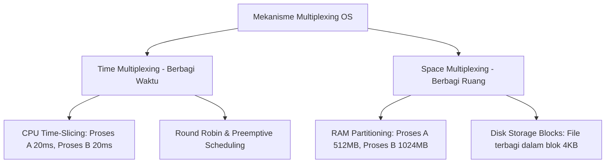

# Bahan Ajar: Minggu 1 - Pengantar Sistem Operasi & Manajemen Sumber Daya

**Mata Kuliah:** Manajemen Sumberdaya Sistem (MKK56301501)  
**Program Studi:** Teknologi Rekayasa Komputer (TRK)  
**Jurusan:** Rekayasa Pertanian dan Komputer – Politeknik Pertanian Negeri Payakumbuh  
**Pertemuan:** 1 (Satu) — Semester 5 / 2 SKS  
**Dosen Pengampu:** Melissa Triandini, M.Kom / Tim Dosen  
**Bahan Kajian:** BK02/MP-01  

---

## 1. Capaian Pembelajaran (Sub-CPMK) & Indikator

Pada akhir sesi perkuliahan ini, mahasiswa diharapkan mampu:
1. **Menjelaskan definisi formal sistem operasi** serta posisinya dalam arsitektur sistem komputer.
2. **Menguraikan dua peran fundamental sistem operasi**: sebagai *Extended Machine* (penyedia abstraksi perangkat lunak) dan sebagai *Resource Manager* (pengelola sumber daya komputasi).
3. **Mengklasifikasikan sumber daya perangkat keras dan perangkat lunak** yang dikelola oleh sistem operasi (CPU, RAM, *Block Storage*, I/O, dan Network).
4. **Membedakan mekanisme alokasi sumber daya**: *Time Multiplexing* (pembagian berbasis waktu) dan *Space Multiplexing* (pembagian berbasis ruang/kapasitas).
5. **Menganalisis dampak kegagalan manajemen sumber daya**, seperti fenomena kebocoran memori (*Memory Leak*) dan mekanisme pertahanan OS melalui *OOM (Out-of-Memory) Killer*.

---

## 2. Definisi dan Kedudukan Sistem Operasi

Sistem Operasi (*Operating System* / OS) adalah perangkat lunak sistem fundamental yang mengontrol dan mengoordinasikan penggunaan perangkat keras (*hardware*) di antara berbagai program aplikasi untuk berbagai pengguna (*users*).

Secara struktural, arsitektur sistem komputer terbagi menjadi empat lapisan utama:
```text
+-------------------------------------------------------------+
|                     Pengguna (Users)                        |
+-------------------------------------------------------------+
|   Aplikasi & Utilitas (Browser, Compiler, Database, Office)  |
+-------------------------------------------------------------+
|         SISTEM OPERASI (Kernel, Device Drivers, VFS)        |
+-------------------------------------------------------------+
|    Perangkat Keras (CPU, RAM, Storage Controller, GPU, NIC) |
+-------------------------------------------------------------+
```

Tanpa sistem operasi, setiap pemrogram aplikasi harus menulis kode mesin tingkat rendah (*assembly/bare-metal*) untuk menggerakkan motor disk magnetik, mengatur timing *refresh* chip DRAM, atau mengontrol register kartu jaringan secara langsung. Sistem operasi hadir untuk menyederhanakan interaksi tersebut sekaligus menjaga agar sistem tetap aman dan stabil.

---

## 3. Dua Sudut Pandang Peran Sistem Operasi

Menurut Tanenbaum & Bos (2022) serta Silberschatz et al. (2019), peran sistem operasi dapat dipahami melalui dua perspektif:

### A. Sudut Pandang Atas-ke-Bawah (*Top-Down View*): Extended Machine / Virtual Machine
Dari sudut pandang pemrogram aplikasi, fungsi utama OS adalah menyediakan **abstraksi**.
- Perangkat keras komputer tingkat rendah sangat rumit, tidak seragam, dan rentan terhadap kesalahan.
- OS menyembunyikan detail fisik perangkat keras (*hardware hiding*) dan menyajikan antarmuka yang bersih, konsisten, dan mudah digunakan.
- **Contoh Abstraksi:**
  - Hard disk fisik terdiri dari piringan magnetik, sektor, silinder, dan motor penggerak. OS mengabstraksikannya menjadi konsep **File** dan **Direktori**.
  - Rangkaian transistor pada chip DRAM diubah menjadi ruang alamat logika (**Virtual Address Space**) yang terisolasi.

### B. Sudut Pandang Bawah-ke-Atas (*Bottom-Up View*): Resource Manager
Dari sudut pandang perangkat keras, OS bertindak sebagai manajer utama (*Resource Manager* atau *Resource Allocator*) yang mengendalikan alokasi komponen sistem:
- Menjaga ketertiban ketika banyak proses atau banyak pengguna bersaing (*competing*) untuk mendapatkan sumber daya yang sama.
- Menjamin pemanfaatan sumber daya berlangsung secara **adil (*fair*)**, **efisien (*efficient*)**, dan **aman (*protected*)**.

---

## 4. Klasifikasi Sumber Daya Sistem yang Dikelola

Sistem komputer modern memiliki dua kategori besar sumber daya:

| Tipe Sumber Daya | Komponen Fisik | Tanggung Jawab Manajemen OS |
| :--- | :--- | :--- |
| **CPU (Pemroses)** | *Cores*, register, ALU | Menentukan proses mana yang berhak dieksekusi, durasi eksekusi, serta mekanisme peralihan antar-proses (*CPU Scheduling & Context Switching*). |
| **Memori Utama (RAM)** | Keping DRAM fisik | Melacak lokasi memori yang kosong vs terisi, mengalokasikan blok memori bagi proses baru, mencegah tabrakan data (*Memory Protection*), dan mengelola *Paging*. |
| **Penyimpanan (*Storage*)** | NVMe SSD, HDD, Flash | Mengatur struktur sistem file (*Ext4, XFS, NTFS*), pemetaan blok disk, *caching*, dan penulisan data yang konsisten. |
| **Perangkat I/O** | Keyboard, Mouse, NIC, Layar | Menangani interupsi perangkat keras, menyediakan antarmuka terpadu melalui *Device Drivers*, dan mengatur *buffering*. |
| **Sumber Daya Lunak** | File descriptor, PID, Socket | Mengelola batas kuota proses (*file limits*, *process limits*), hak akses (*permissions*), dan IPC (*Inter-Process Communication*). |

---

## 5. Konsep Dasar Multiplexing: Time vs Space Multiplexing

Agar berbagai program dapat berjalan bersamaan (*multitasking / multiprogramming*) pada komputer dengan sumber daya fisik terbatas, sistem operasi menerapkan konsep **Multiplexing** (berbagi sumber daya) melalui dua teknik utama:



### 1. Time Multiplexing (Berbagi Berdasarkan Waktu)
Berbagai program bergantian menggunakan satu sumber daya fisik dalam rentang waktu tertentu:
- **Prinsip:** Pengguna atau program A menggunakan CPU selama sekian milidetik (*quantum time*), kemudian OS menghentikannya dan memberikan CPU kepada program B.
- **Contoh Komponen:**
  - **CPU:** Satu inti CPU (*Single Core*) dapat menjalankan puluhan aplikasi secara bersamaan karena CPU beralih konteks (*context switch*) ribuan kali per detik, menciptakan ilusi eksekusi paralel simultan (*concurrency*).
  - **Network Interface Card (NIC):** Paket data dari aplikasi browser dan aplikasi streaming dikirimkan bergantian melalui kartu jaringan yang sama.

### 2. Space Multiplexing (Berbagi Berdasarkan Ruang / Kapasitas)
Alih-alih menunggu giliran, setiap program diberikan sebagian dari total kapasitas ruang yang tersedia:
- **Prinsip:** Sumber daya fisik dibagi-bagi menjadi partisi atau blok-blok independen yang dapat dihuni secara bersamaan oleh banyak proses.
- **Contoh Komponen:**
  - **RAM (Memori Utama):** Total memori 16 GB dibagi; sistem operasi mengambil 2 GB, browser mengambil 4 GB, dan database mengambil 4 GB secara berdampingan.
  - **Hard Disk / SSD:** Ruang penyimpanan 512 GB dibagi ke dalam jutaan blok data (biasanya berukuran 4 KB) yang dialokasikan untuk ribuan file berbeda secara simultan.

---

## 6. Studi Kasus Teknis: Analisis Memory Leak dan Mitigasi OS

### A. Anatomi Kebocoran Memori (*Memory Leak*)
Kebocoran memori terjadi ketika sebuah program aplikasi mengalokasikan memori dinamis di area *Heap* (misalnya menggunakan fungsi `malloc()` di bahasa C atau instansiasi objek di Java/Python), namun gagal membebaskan kembali memori tersebut (`free()` atau siklus *garbage collection*) setelah data tidak lagi diperlukan.

```c
// Contoh simulasi memory leak dalam C
void memory_leak_function() {
    int *buffer = (int *)malloc(1024 * sizeof(int)); // Alokasi 4 KB di Heap
    // ... program menggunakan buffer ...
    // Kesalahan fatal: Pemrogram lupa memanggil free(buffer);
    return; // Pointer 'buffer' hilang dari Stack, namun memori 4 KB tetap tertahan di Heap!
}
```

Jika fungsi di atas dipanggil jutaan kali dalam aplikasi berjenis *long-running service* (seperti web server atau bot), penggunaan RAM proses tersebut akan merangkak naik secara kontinu hingga menghabiskan seluruh memori bebas (*free memory*) sistem.

### B. Mekanisme Proteksi Sistem Operasi
Mengapa satu aplikasi yang mengalami *memory leak* tidak langsung merusak memori aplikasi lain?
1. **Isolasi Ruang Alamat Virtual (*Virtual Memory Protection*):**
   Setiap proses di Linux berjalan di dalam ruang alamat virtualnya sendiri yang diisolasi oleh hardware *Memory Management Unit* (MMU). Proses A tidak memiliki akses fisik ke ruang memori Proses B.
2. **Penggunaan Swap Space:**
   Ketika RAM fisik mulai habis, OS memindahkan halaman-halaman memori yang jarang diakses ke media penyimpanan (*Swap Space*). Hal ini memperlambat sistem (*thrashing*), namun mencegah terjadinya *system crash* seketika.
3. **Out-of-Memory (OOM) Killer pada Linux:**
   Jika memori fisik dan swap benar-benar habis total (*exhausted*), kernel Linux mengaktifkan subsistem darurat yang disebut **OOM Killer**.
   - Kernel menghitung skor keparahan (*badness score*) dari setiap proses yang berjalan berdasarkan persentase konsumsi memori dan waktu hidupnya.
   - Proses dengan skor tertinggi (umumnya proses yang membocorkan memori) akan dimatikan secara paksa dengan sinyal `SIGKILL` (sinyal 9) demi menyelamatkan kernel dan sistem secara keseluruhan.

---

## 7. Rangkuman Materi

1. Sistem operasi bertindak ganda sebagai **Extended Machine** (abstraksi hardware tingkat tinggi) dan **Resource Manager** (pengendali alokasi hardware yang efisien dan adil).
2. Sumber daya sistem dikelola melalui dua paradigma berbagi: **Time Multiplexing** (seperti CPU Time-Slicing) dan **Space Multiplexing** (seperti partisi RAM dan alokasi blok disk).
3. Kegagalan pengelolaan memori pada tingkat aplikasi (*Memory Leak*) ditangani oleh OS melalui kombinasi isolasi memori virtual, swapping, dan intervensi darurat OOM Killer.

---

## 8. Referensi Pustaka

- **Silberschatz, A., Galvin, P. B., & Gagne, G. (2019).** *Operating System Concepts* (10th Global Edition). John Wiley & Sons. **Chapter 1: Introduction (pp. 3–50).**
- **Tanenbaum, A. S., & Bos, H. (2022).** *Modern Operating Systems* (5th Edition). Pearson. **Chapter 1: Introduction — What is an Operating System & The Operating System as a Resource Manager (pp. 21–45).**
- **Nemeth, E., et al. (2017).** *UNIX and Linux System Administration Handbook* (5th Edition). Pearson. **Chapter 2: Booting and System Management Basics.**
