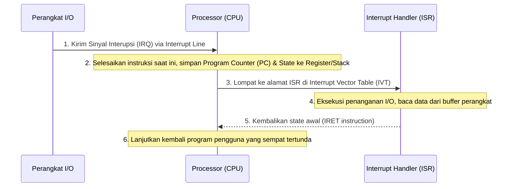

# Bahan Ajar: Minggu 2 - Struktur Sistem Komputer dan Sistem Operasi

**Mata Kuliah:** Manajemen Sumberdaya Sistem (MKK56301501)  
**Program Studi:** Teknologi Rekayasa Komputer (TRK)  
**Jurusan:** Rekayasa Pertanian dan Komputer – Politeknik Pertanian Negeri Payakumbuh  
**Pertemuan:** 2 (Dua) — Semester 5 / 2 SKS  
**Dosen Pengampu:** Melissa Triandini, M.Kom / Tim Dosen  
**Bahan Kajian:** BK02/MP-02  

---

## 1. Capaian Pembelajaran (Sub-CPMK) & Indikator

Pada akhir sesi perkuliahan ini, mahasiswa diharapkan mampu:
1. **Menganalisis struktur perangkat keras sistem komputer modern**, termasuk bus sistem, memori utama, pengontrol perangkat (*device controllers*), dan *Direct Memory Access* (DMA).
2. **Menguraikan mekanisme interupsi perangkat keras (*Hardware Interrupt*) dan perangkat lunak (*Trap / Exception*)**, serta siklus penanganan interupsi oleh CPU (*Interrupt Service Routine* / ISR).
3. **Menjelaskan prinsip operasi dua mode (*Dual-Mode Operation*)**: *User Mode* dan *Kernel Mode*, peran *mode bit*, dan pentingnya instruksi *privileged*.
4. **Menganalisis mekanisme kerja *System Call*** sebagai jembatan resmi antara ruang pengguna (*User Space*) dan ruang kernel (*Kernel Space*).
5. **Membandingkan arsitektur kernel sistem operasi**: *Monolithic Kernel*, *Microkernel*, dan *Hybrid Kernel*.

---

## 2. Struktur Perangkat Keras Komputer Modern

Sistem komputer modern terdiri atas satu atau lebih CPU, memori utama (RAM), dan sejumlah pengontrol perangkat (*Device Controllers*) yang terhubung melalui satu sistem bus bersama (*System Bus*) yang menyediakan akses ke memori fisik.

```text
+-----------------------------------------------------------------+
|                          SYSTEM BUS                             |
+--------+----------------+----------------+----------------+-----+
         |                |                |                |
   +-----+----+     +-----+----+     +-----+----+     +-----+----+
   |   CPU    |     | Disk Ctrl|     | USB Ctrl |     | MEMORY   |
   | (Cores,  |     |  (NVMe/  |     | (Mouse,  |     | (Shared  |
   | L1/L2/L3)|     |   SATA)  |     | Keyboard)|     |  DRAM)   |
   +----------+     +-----+----+     +-----+----+     +----------+
                          |                |
                      [Storage]       [Peripherals]
```

### A. Operasi Komputer Bersamaan (*Concurrent Operation*)
- CPU dan pengontrol perangkat dapat mengeksekusi instruksi secara bersamaan (*concurrently*), bersaing memperebutkan siklus akses memori.
- Setiap *Device Controller* memiliki register kendali (*Control, Status, Data-In, Data-Out*) dan *local buffer* sendiri.
- Untuk memindahkan data dalam jumlah besar (misalnya transfer blok disk ke RAM), digunakan mekanisme **Direct Memory Access (DMA)** di mana controller memindahkan seluruh blok data langsung ke RAM tanpa campur tangan CPU untuk setiap byte data, sehingga CPU bebas mengerjakan komputasi lain.

---

## 3. Mekanisme Interupsi (Interrupt Mechanism)

Interupsi adalah mekanisme fundamental yang digunakan oleh perangkat keras dan perangkat lunak untuk memberi tahu CPU bahwa ada suatu peristiwa (*event*) yang membutuhkan perhatian mendesak.



### Klasifikasi Interupsi:
1. **Hardware Interrupt (Asinkron):**
   - Dipicu secara fisik oleh sinyal listrik melalui kabel *Interrupt Request* (IRQ) dari pengontrol perangkat keras.
   - Contoh: Ketukan tombol keyboard, tibanya paket data pada kartu jaringan (NIC), atau sinyal timer perangkat keras (*timer interrupt*) yang memicu pergantian giliran CPU (*preemption*).
2. **Software Interrupt / Trap / Exception (Sinkron):**
   - Dipicu langsung oleh perangkat lunak saat CPU mengeksekusi suatu instruksi tertentu.
   - Terbagi menjadi dua kategori:
     - **Exception / Fault:** Terjadi akibat kesalahan eksekusi program (contoh: *Division by zero*, *Page Fault*, pelanggaran akses memori *Segmentation Fault*).
     - **System Call:** Permintaan sengaja dari aplikasi kepada kernel untuk meminta layanan istimewa (contoh: membaca file atau membuat proses).

---

## 4. Dual-Mode Operation: User Mode vs Kernel Mode

Untuk mencegah program pengguna (*user application*) merusak integritas sistem operasi atau memata-matai proses pengguna lain, arsitektur prosesor modern menyediakan dukungan perangkat keras berupa **Operasi Dua Mode**:

```text
+-----------------------------------------------------------------+
| USER SPACE (User Mode: Mode Bit = 1)                            |
| - Aplikasi Web, Python, Database, Word Processor                |
| - Instruksi dibatasi: DILARANG mengakses register hardware/MMU  |
+-----------------------------------------------------------------+
                     |                          ^
        System Call  |                          | Return from
     (Trap / Syscall)|                          | System Call
                     v                          |
+-----------------------------------------------------------------+
| KERNEL SPACE (Kernel Mode / Supervisor Mode: Mode Bit = 0)      |
| - Kernel Linux, Scheduler, Device Drivers, Virtual Memory       |
| - Akses penuh tanpa batas ke seluruh instruksi fisik hardware   |
+-----------------------------------------------------------------+
```

### A. Peran Mode Bit
- Chip CPU memiliki sebuah register status yang menyimpan **Mode Bit**:
  - `0` menandakan **Kernel Mode** (juga disebut *Supervisor Mode*, *System Mode*, atau *Ring 0*).
  - `1` menandakan **User Mode** (*Ring 3*).
- Saat komputer pertama kali menyala (*booting*), CPU berjalan di *Kernel Mode*. Begitu OS selesai dimuat dan hendak menjalankan program pengguna pertama kali, OS mengubah *Mode Bit* menjadi `1`.

### B. Instruksi Istimewa (*Privileged Instructions*)
Instruksi CPU tertentu dikategorikan sebagai *Privileged* dan **HANYA** boleh dieksekusi ketika *Mode Bit* bernilai `0`:
1. Instruksi memodifikasi tabel halaman memori (*Page Table Base Register* / CR3 pada x86).
2. Instruksi menonaktifkan atau mengaktifkan interupsi hardware (`CLI` / `STI`).
3. Instruksi langsung membaca atau menulis port register I/O (`IN` / `OUT`).
4. Instruksi mengubah nilai *Mode Bit* itu sendiri.

Jika program di *User Mode* mencoba mengeksekusi instruksi *privileged*, perangkat keras CPU tidak akan menjalankannya melainkan langsung membangkitkan *Trap / General Protection Fault*, dan kernel OS akan mematikan proses pelanggar tersebut.

---

## 5. Anatomi Pemanggilan Sistem (System Call Execution Flow)

Bagaimana sebuah aplikasi pengguna dapat membaca data dari hard disk jika ia dilarang mengakses perangkat keras secara langsung? Jawabannya adalah melalui **System Call**.

### Tahapan Eksekusi System Call (Contoh: `read()`):
1. **Pemanggilan Fungsi Wrapper:** Aplikasi memanggil fungsi standar pustaka bahasa C (glibc), misalnya `read(fd, buffer, count)`.
2. **Penyusunan Register:** Pustaka glibc menyalin argumen ke register CPU tertentu (pada x86_64: register `RAX` diisi dengan nomor ID system call, misal nomor `0` untuk `sys_read`).
3. **Transisi Mode (Trap):** Glibc mengeksekusi instruksi mesin khusus `syscall` (pada prosesor 64-bit modern) atau `int 0x80` (pada arsitektur legacy x86 32-bit).
4. **Intervensi Perangkat Keras:** CPU secara otomatis menyimpan status eksekusi program pengguna, mengubah *Mode Bit* dari `1` ke `0` (*Kernel Mode*), dan melompat ke alamat *System Call Dispatcher* di kernel.
5. **Eksekusi Handler Kernel:** Kernel membaca ID di register `RAX`, memeriksa keabsahan hak akses dan argumen, lalu memanggil fungsi handler kernel yang sebenarnya (`sys_read()`).
6. **Pengembalian Hasil:** Kernel meletakkan hasil pembacaan (jumlah byte yang dibaca) ke dalam register kembali, mengeksekusi instruksi `sysret` yang mengembalikan CPU ke *User Mode* (*Mode Bit* = `1`), dan eksekusi program pengguna berlanjut.

Alat bantu seperti utilitas `strace` di Linux bekerja dengan cara mencegat (*intercepting*) transisi ini, sehingga administrator dapat membedah setiap *system call* yang dipanggil oleh suatu aplikasi tanpa perlu melihat kode sumber aslinya.

---

## 6. Spektrum Arsitektur Kernel Sistem Operasi

Terdapat tiga paradigma utama dalam merancang arsitektur kernel sistem operasi:

```text
[1. Monolithic Kernel]            [2. Microkernel]
+---------------------------+     +---------------------------+
|    User Applications      |     |  Apps | File Server | VFS | (User Mode)
+---------------------------+     +---------------------------+
|   VFS  | Scheduler | IPC  |     |  IPC | Virtual Memory     | (Kernel Mode)
| FileSys| Drivers   | Net  |     +---------------------------+
| (Seluruh komponen ada di  |     
|  Kernel Mode)             |
+---------------------------+
```

1. **Monolithic Kernel (Contoh: Linux, FreeBSD):**
   - Seluruh layanan sistem operasi (manajemen proses, memori, driver perangkat keras, sistem file, dan stack jaringan) berjalan bersama-sama di ruang alamat kernel yang sama (*Kernel Space*).
   - **Kelebihan:** Sangat cepat dan efisien karena komunikasi antarkomponen dilakukan lewat pemanggilan fungsi langsung di memori, tanpa *overhead context switch*.
   - **Kekurangan:** Jika sebuah *device driver* memiliki bug kritis (misal pointer rusak), bug tersebut dapat membuat seluruh kernel macet (*Kernel Panic / Blue Screen*).
2. **Microkernel (Contoh: Mach, QNX, MINIX 3):**
   - Kernel dibuat sekecil mungkin. Hanya fungsi paling mendasar (manajemen memori primitif, thread scheduling dasar, dan fasilitas komunikasi pesan / IPC) yang berada di *Kernel Mode*.
   - Komponen lain (sistem file, network driver, device driver) dipindahkan ke *User Space* sebagai proses server (*daemons*).
   - **Kelebihan:** Keandalan (*reliability*) dan modularitas sangat tinggi. Jika driver disk crash, ia dapat di-restart tanpa mematikan sistem.
   - **Kekurangan:** Komunikasi antarkomponen membutuhkan banyak pertukaran pesan (IPC) yang memicu *context switch* berulang-ulang sehingga kinerjanya cenderung lebih lambat.
3. **Hybrid Kernel (Contoh: Windows NT Kernel, Apple macOS/iOS XNU):**
   - Pendekatan gabungan yang mempertahankan kecepatan *monolithic* dengan struktur modularitas dan abstractions ala *microkernel*.

---

## 7. Rangkuman Materi

1. Komputer beroperasi secara paralel antara CPU dan *Device Controllers* yang dihubungkan melalui sistem bus dan diringankan oleh *DMA Controller*.
2. Mekanisme **Interrupt** memungkinkan hardware memberi tahu CPU secara efisien tanpa CPU harus membuang siklus untuk polling.
3. **Dual-Mode Operation** (*User* vs *Kernel Mode*) dikawal oleh perangkat keras melalui *Mode Bit* untuk mencegah program sembarangan mengeksekusi instruksi *privileged*.
4. **System Call** adalah pintu gerbang terkontrol bagi aplikasi pengguna untuk meminta kernel mengeksekusi operasi terlindungi melalui instruksi trap/syscall.
5. Arsitektur **Monolithic** (seperti Linux) memprioritaskan performa eksekusi langsung, sedangkan **Microkernel** memprioritaskan keamanan dan ketahanan sistem.

---

## 8. Referensi Pustaka

- **Silberschatz, A., Galvin, P. B., & Gagne, G. (2019).** *Operating System Concepts* (10th Global Edition). John Wiley & Sons. **Chapter 1: Computer-System Organization & Architecture (pp. 9–25); Chapter 2: Operating-System Structures & System Calls (pp. 55–90).**
- **Tanenbaum, A. S., & Bos, H. (2022).** *Modern Operating Systems* (5th Edition). Pearson. **Chapter 1: Computer Hardware Review & System Calls (pp. 46–78).**
- **Nemeth, E., et al. (2017).** *UNIX and Linux System Administration Handbook* (5th Edition). Pearson. **Chapter 3: The Linux Kernel Architecture.**
