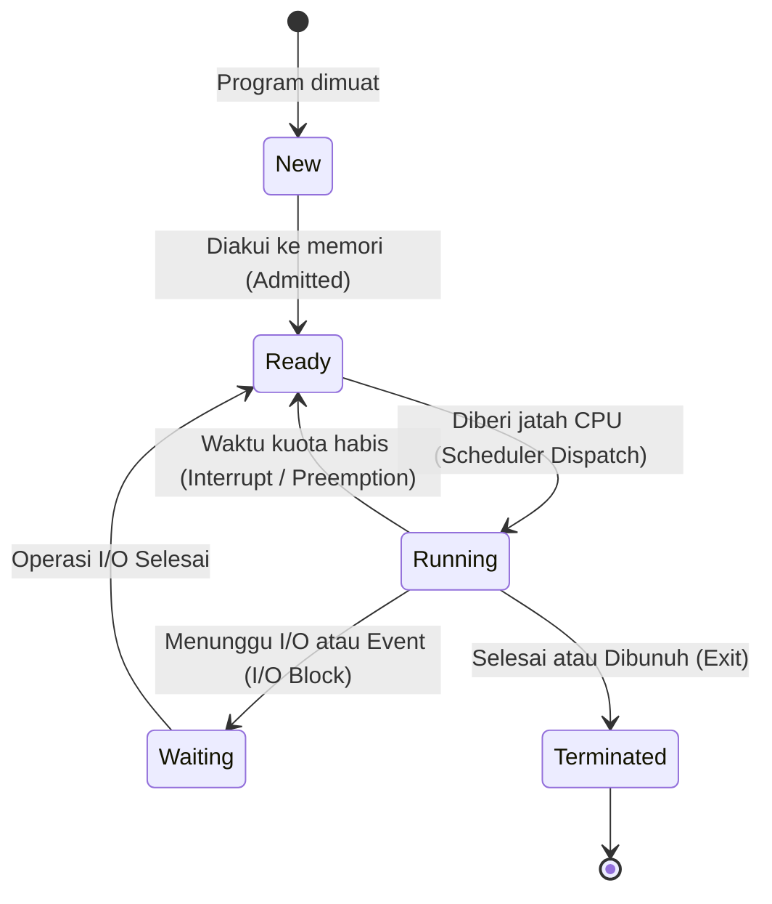
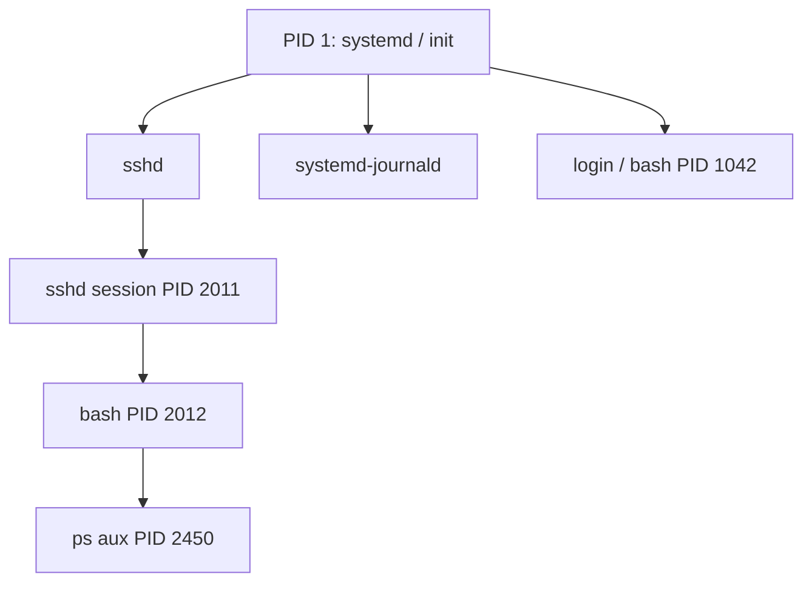

# Bahan Ajar: Minggu 3 - Manajemen Proses dan Thread

**Mata Kuliah:** Manajemen Sumberdaya Sistem (MKK56301501)  
**Program Studi:** Teknologi Rekayasa Komputer (TRK)  
**Jurusan:** Rekayasa Pertanian dan Komputer – Politeknik Pertanian Negeri Payakumbuh  
**Pertemuan:** 3 (Tiga) — Semester 5 / 2 SKS  
**Dosen Pengampu:** Melissa Triandini, M.Kom / Tim Dosen  
**Bahan Kajian:** BK02/MP-03  

---

## 1. Capaian Pembelajaran (Sub-CPMK) & Indikator

Pada akhir sesi perkuliahan ini, mahasiswa diharapkan mampu:
1. **Membedakan program pasif dengan proses aktif**, serta menguraikan struktur tata letak memori (*Memory Layout*) sebuah proses.
2. **Menganalisis siklus hidup dan diagram transisi status proses (*Process State Diagram*)**.
3. **Menguraikan isi dan fungsi *Process Control Block* (PCB)** atau `struct task_struct` pada kernel Linux.
4. **Menjelaskan mekanisme dan *overhead* dari *Context Switching*** pada penjadwalan proses.
5. **Membandingkan proses dengan *thread***, serta menganalisis model pemetaan *thread* (*Many-to-One*, *One-to-One*, *Many-to-Many*).
6. **Menganalisis hierarki proses Linux**, termasuk fenomena proses *Parent-Child*, *Zombie Process*, dan *Orphan Process*.

---

## 2. Program vs Proses dan Tata Letak Memori (Memory Layout)

- **Program:** Entitas pasif (*passive entity*), berupa file biner berekstensi eksekutabel (seperti file ELF di Linux atau `.exe` di Windows) yang tersimpan di media penyimpanan sekunder (*disk*).
- **Proses:** Entitas aktif (*active entity*), yaitu sebuah program yang telah dimuat ke dalam memori utama (RAM) dan sedang dieksekusi oleh CPU, lengkap dengan *Program Counter* dan sekumpulan sumber daya sistem.

Ketika sebuah program dieksekusi menjadi proses, sistem operasi mengalokasikan ruang alamat virtual (*Virtual Address Space*) dengan struktur terbagi sebagai berikut:

```text
+---------------------------------------+ 0xFFFFFFFF (Alamat Tinggi)
|                STACK                  |  <- Variabel lokal, parameter fungsi,
|                  |                    |     alamat kembali (tumbuh ke bawah)
|                  v                    |
|                                       |
|                  ^                    |
|                  |                    |
|                 HEAP                  |  <- Alokasi dinamis (malloc/new)
+---------------------------------------+     (tumbuh ke atas)
|            BSS SEGMENT                |  <- Variabel global/statis tanpa inisialisasi
+---------------------------------------+
|            DATA SEGMENT               |  <- Variabel global/statis terinisialisasi
+---------------------------------------+
|            TEXT SEGMENT               |  <- Instruksi kode mesin biner program
+---------------------------------------+ 0x00000000 (Alamat Rendah)
```

---

## 3. Siklus Hidup dan Diagram Status Proses (Process States)

Sepanjang keberadaannya, sebuah proses berpindah dari satu status (*state*) ke status lain sesuai dengan kondisi eksekusi dan penjadwalan CPU:



1. **New:** Proses sedang dibuat dan disiapkan oleh kernel OS.
2. **Ready:** Proses berada di memori utama, siap dieksekusi, dan menunggu giliran alokasi CPU di antrean siap (*Ready Queue*).
3. **Running:** Instruksi-instruksi proses sedang dieksekusi langsung oleh inti CPU.
4. **Waiting / Blocked:** Proses tidak dapat berjalan karena sedang menunggu suatu peristiwa selesai (misalnya menunggu data dari hardisk, ketukan keyboard, atau paket jaringan).
5. **Terminated:** Proses telah menyelesaikan eksekusinya atau dihentikan secara paksa (`kill`), menunggu tabelnya dibersihkan oleh proses induk.

---

## 4. Process Control Block (PCB) & task_struct di Linux

Setiap proses diwakili di dalam kernel oleh sebuah blok kontrol khusus bernama **Process Control Block (PCB)**. Pada kernel Linux, PCB didefinisikan sebagai struktur bahasa C bernama `struct task_struct` (didefinisikan di `<linux/sched.h>`).

### Informasi Kunci di dalam PCB:
- **Process Identification (PID & PPID):** Nomor pengenal unik proses (`PID`) dan pengenal proses induk yang menciptakannya (`PPID`).
- **Process State:** Menyimpan status terkini (`TASK_RUNNING`, `TASK_INTERRUPTIBLE`, `TASK_UNINTERRUPTIBLE`, `TASK_ZOMBIE`, dll.).
- **Program Counter (PC):** Alamat memori dari instruksi berikutnya yang harus dieksekusi ketika proses ini kembali mendapatkan CPU.
- **CPU Registers:** Nilai akumulator, index register, stack pointer, dan status flag CPU saat proses dialihkan.
- **CPU Scheduling Information:** Prioritas proses, nilai *niceness* (berkisar antara -20 hingga 19), dan pointer ke antrean penjadwal.
- **Memory Management Information:** Informasi tabel halaman (*page tables*), batas segmen memori virtual (`mm_struct`).
- **Accounting Information:** Jumlah waktu CPU yang telah digunakan, batas waktu eksekusi.
- **I/O Status Information:** Daftar berkas yang sedang dibuka oleh proses melalui tabel *File Descriptors* (`0: stdin, 1: stdout, 2: stderr`, dsb).

---

## 5. Mekanisme dan Biaya Context Switching

**Context Switch** adalah mekanisme penyimpanan status proses yang sedang berjalan ke dalam PCB-nya, diikuti dengan pemuatan status proses lain dari PCB-nya ke dalam register CPU, sehingga CPU dapat beralih menjalankan proses baru.

```text
Proses P0                    Sistem Operasi                    Proses P1
   |                              |                                |
 Mengeksekusi...                  |                                |
   |  Interrupt / System Call     |                                |
   +----------------------------->|                                |
                               Simpan state ke PCB0                |
                               Pilih proses berikutnya             |
                               Muat state dari PCB1                |
                                  |------------------------------->|
                                  |                          Mengeksekusi...
                                  |                             |
                                  |<----------------------------+
                               Simpan state ke PCB1
                               Muat state dari PCB0
   |<-----------------------------|
 Mengeksekusi...
```

### Overhead dari Context Switch:
Waktu yang dihabiskan untuk *Context Switching* adalah waktu terbuang murni (*pure overhead*) karena CPU tidak menjalankan instruksi komputasi yang berguna bagi pengguna selama proses pertukaran berlangsung.
- Selain menyalin register, context switch memicu efek samping kinerja berupa pengosongan *cache* CPU (*Cache Invalidation*) dan pengosongan tabel alamat virtual (*TLB Flushing*).
- Desain sistem operasi berkinerja tinggi berupaya meminimalkan frekuensi context switch yang tidak perlu.

---

## 6. Proses vs Thread (Konsep Ringan / Lightweight Process)

Sebuah **Thread** (disebut juga *Lightweight Process* / LWP) adalah unit dasar utilisasi CPU yang terdiri atas *Thread ID*, *Program Counter*, *Register Set*, dan *Stack* sendiri.

```text
PROSES TUNGGAL (Single-Threaded)        PROSES DENGAN MULTITHREADING
+-----------------------------------+   +-----------------------------------+
| Code    | Data     | Files        |   | Code    | Data     | Files        |
+-----------------------------------+   +-----------------------------------+
| Registers           | Stack       |   | Regs | Regs | Regs | Stack| Stack | Stack
+-----------------------------------+   +-----------------------------------+
         (1 Alur Eksekusi)                       (3 Thread Eksekusi Simultan)
```

### Karakteristik Berbagi Sumber Daya Antar-Thread:
- **Dibagi Bersama (*Shared*):** Seluruh thread dalam proses yang sama berbagi segmen **Code/Text**, segmen **Data** (variabel global), alokasi **Heap**, dan berkas yang terbuka (**Open Files**).
- **Independen (*Private*):** Setiap thread memiliki nilai register CPU, Program Counter, dan alokasi **Stack** sendiri untuk menampung pemanggilan fungsi independennya.

### Model Pemetaan Thread:
1. **Many-to-One (N:1):** Banyak thread tingkat pengguna dipetakan ke 1 kernel thread. Sangat efisien, namun jika 1 thread melakukan operasi I/O yang memblokir, seluruh aplikasi ikut macet.
2. **One-to-One (1:1):** Setiap thread pengguna dipetakan langsung ke 1 kernel thread. Model ini diadopsi oleh Linux modern (melalui pustaka *Native POSIX Thread Library* / NPTL dan fungsi kernel `clone()`). Memberikan konkurensi sejati pada arsitektur prosesor *multi-core*.
3. **Many-to-Many (M:N):** Banyak thread pengguna dipetakan ke kernel thread dengan jumlah yang fleksibel.

---

## 7. Hierarki Proses Linux: Parent, Child, Zombie, dan Orphan

Di Linux, seluruh proses tersusun dalam satu pohon hierarki (*Process Tree*) yang berakar pada proses pertama bernama **PID 1** (pada sistem Linux modern adalah `systemd`, atau `init` pada sistem lama).



### Mekanisme Fork-Exec:
- Proses baru dibuat melalui pemanggilan *system call* `fork()`. Kernel menyalin ruang alamat proses induk (*Parent*) ke proses anak (*Child*) menggunakan teknik hemat memori *Copy-on-Write* (COW).
- Proses anak kemudian memanggil `execve()` untuk mengganti instruksi memorinya dengan kode program baru.
- Proses induk memanggil `wait()` atau `waitpid()` untuk menunggu anak selesai dan membaca kode status penghentiannya (*exit status*).

### Dua Kondisi Anomali Proses:
1. **Zombie Process (`<defunct>`):**
   - Terjadi ketika proses anak telah selesai dieksekusi (`exit(0)`), namun proses induknya belum memanggil fungsi `wait()`.
   - Proses ini tidak lagi menggunakan CPU atau RAM, namun entri PCB-nya masih tertahan di tabel proses kernel Linux demi menyimpan status penghentian bagi sang induk.
2. **Orphan Process (Proses Yatim):**
   - Terjadi jika proses induk mati atau berhenti mendadak sementara proses anak masih terus berjalan.
   - Kernel Linux secara otomatis akan mengadopsi proses yatim ini ke **PID 1 (`systemd`)**. Ketika proses anak ini akhirnya selesai, `systemd` akan segera memanggil `wait()` sehingga proses tidak akan berubah menjadi zombie permanen.

---

## 8. Rangkuman Materi

1. **Proses** adalah program yang sedang dieksekusi, memiliki ruang memori terstruktur (Text, Data, BSS, Heap, dan Stack).
2. **Status proses** berputar antara *Ready*, *Running*, dan *Waiting*, diatur oleh penjadwal OS.
3. Seluruh metadata proses dicatat dalam **PCB / `task_struct`**. Pertukaran eksekusi antar-proses disebut **Context Switch**.
4. **Thread** memungkinkan eksekusi paralel di dalam proses yang sama dengan berbagi ruang memori (Heap & Data) namun memiliki Stack mandiri.
5. Proses di Linux membentuk pohon berakar pada PID 1 (`systemd`), dan memerlukan pemanggilan `wait()` oleh parent agar tidak meninggalkan **Zombie**.

---

## 9. Referensi Pustaka

- **Silberschatz, A., Galvin, P. B., & Gagne, G. (2019).** *Operating System Concepts* (10th Global Edition). John Wiley & Sons. **Chapter 3: Processes (pp. 105–150); Chapter 4: Threads & Concurrency (pp. 161–196).**
- **Tanenbaum, A. S., & Bos, H. (2022).** *Modern Operating Systems* (5th Edition). Pearson. **Chapter 2: Processes and Threads (pp. 83–128).**
- **Nemeth, E., et al. (2017).** *UNIX and Linux System Administration Handbook* (5th Edition). Pearson. **Chapter 4: Process Control (pp. 67–88).**
