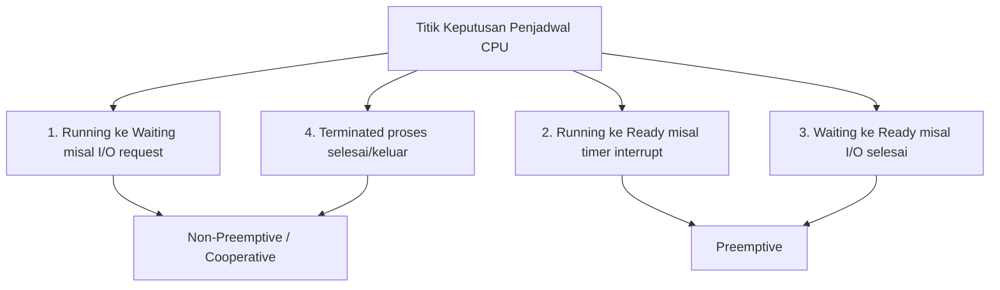

# Bahan Ajar: Minggu 4 - Penjadwalan CPU (CPU Scheduling)

**Mata Kuliah:** Manajemen Sumberdaya Sistem (MKK56301501)  
**Program Studi:** Teknologi Rekayasa Komputer (TRK)  
**Jurusan:** Rekayasa Pertanian dan Komputer – Politeknik Pertanian Negeri Payakumbuh  
**Pertemuan:** 4 (Empat) — Semester 5 / 2 SKS  
**Dosen Pengampu:** Melissa Triandini, M.Kom / Tim Dosen  
**Bahan Kajian:** BK02/MP-04  

---

## 1. Capaian Pembelajaran (Sub-CPMK) & Indikator

Pada akhir sesi perkuliahan ini, mahasiswa diharapkan mampu:
1. **Menjelaskan konsep siklus komputasi (*CPU-I/O Burst Cycle*)** dan peran penjadwal jangka pendek (*CPU Scheduler*) serta *Dispatcher*.
2. **Membedakan penjadwalan *Preemptive* dan *Non-preemptive*** berdasarkan 4 kondisi peralihan status proses.
3. **Menganalisis 5 kriteria optimasi penjadwalan CPU**: *CPU Utilization*, *Throughput*, *Turnaround Time*, *Waiting Time*, dan *Response Time*.
4. **Menghitung dan memvisualisasikan eksekusi proses melalui Gantt Chart** untuk algoritma FCFS, SJF (*Preemptive* dan *Non-preemptive*), serta Round Robin.
5. **Menganalisis anomali dan kelemahan algoritma**: fenomena *Convoy Effect*, *Starvation*, penanganan *Aging*, serta trade-off penentuan ukuran *Time Quantum*.
6. **Menjelaskan konsep *Multilevel Queue* dan *Multilevel Feedback Queue* (MLFQ)**, serta pengenalan penjadwal modern Linux *Completely Fair Scheduler* (CFS).

---

## 2. Siklus CPU-I/O Burst dan Arsitektur Penjadwal

Keberhasilan sistem *multiprogramming* bergantung pada sifat inheren dari setiap proses komputasi: eksekusi proses terdiri atas perulangan siklus antara eksekusi CPU (**CPU Burst**) dan penantian operasi I/O (**I/O Burst**).

```text
+-------------------+      +-------------------+      +-------------------+
|     CPU Burst     | ---> |     I/O Burst     | ---> |     CPU Burst     | ---> ...
| (Komputasi Aktif) |      | (Menunggu Disk/Net|      | (Komputasi Aktif) |
+-------------------+      +-------------------+      +-------------------+
```

- **CPU-Bound Process:** Menghabiskan mayoritas waktunya melakukan perhitungan intensif matematika (memiliki siklus CPU burst yang sangat panjang dan jarang memanggil I/O).
- **I/O-Bound Process:** Menghabiskan mayoritas waktunya menunggu piranti I/O (memiliki siklus CPU burst yang sangat pendek dan sering beralih ke status waiting).

### Komponen Penjadwalan:
1. **CPU Scheduler (Short-term Scheduler):** Memilih satu proses dari antrean siap (*Ready Queue*) di memori utama untuk dialokasikan ke inti CPU.
2. **Dispatcher:** Modul perangkat lunak kernel yang bertugas memberikan kendali CPU ke proses yang dipilih oleh scheduler. Tugas dispatcher mencakup:
   - Melakukan pertukaran konteks (*Context Switching*).
   - Mengubah mode CPU dari *Kernel Mode* ke *User Mode*.
   - Melompat ke lokasi instruksi program pengguna yang sesuai untuk memulai kembali eksekusi.
   - Waktu yang dibutuhkan oleh dispatcher disebut **Dispatch Latency**.

---

## 3. Preemptive vs Non-Preemptive Scheduling

Keputusan penjadwalan CPU dapat terjadi dalam empat kondisi status proses:



- **Non-Preemptive (Kooperatif):** Begitu CPU dialokasikan ke suatu proses, proses tersebut memegang kendali CPU sampai ia melepaskannya secara sukarela (baik karena meminta operasi I/O pada kondisi 1, atau selesai dieksekusi pada kondisi 4). CPU tidak dapat direbut paksa di tengah jalan.
- **Preemptive:** Sistem operasi berhak merebut paksa CPU dari proses yang sedang berjalan ketika jatah waktunya (*time slice*) habis akibat interupsi timer hardware (kondisi 2), atau ketika ada proses dengan prioritas lebih tinggi tiba di sistem (kondisi 3).

---

## 4. Kriteria Evaluasi dan Optimasi Penjadwalan

Dalam mengevaluasi algoritma penjadwalan, sistem operasi menggunakan lima metrik kuantitatif:

1. **CPU Utilization (Utilitas CPU):** Menjaga prosesor bekerja sesibuk mungkin (target optimal: 40% pada sistem beban ringan, hingga 90% pada sistem beban berat).
2. **Throughput:** Jumlah proses yang berhasil diselesaikan per satuan waktu (contoh: 50 proses per menit).
3. **Turnaround Time (TAT):** Total interval waktu yang dihabiskan proses mulai dari saat pertama kali tiba di sistem (*Arrival Time* / AT) hingga selesai secara penuh (*Completion Time* / CT).
   $$\text{TAT} = \text{Completion Time (CT)} - \text{Arrival Time (AT)}$$
4. **Waiting Time (WT):** Jumlah total waktu yang dihabiskan oleh proses berada di dalam *Ready Queue* menunggu giliran eksekusi CPU.
   $$\text{WT} = \text{Turnaround Time (TAT)} - \text{Burst Time (BT)}$$
5. **Response Time:** Waktu dari penyerahan permintaan (*request submission*) hingga respons pertama dihasilkan (krusial bagi sistem interaktif / desktop UI).

---

## 5. Algoritma Penjadwalan Klasik dan Perhitungannya

### A. First-Come, First-Served (FCFS)
- **Prinsip:** Proses yang meminta CPU terlebih dahulu akan dilayani terlebih dahulu (antrean FIFO standar). Bersifat *Non-Preemptive*.
- **Kelemahan Kritis — Convoy Effect:**
  Jika proses dengan CPU burst besar tiba lebih dulu (misal P1 = 24 ms), proses-proses kecil berikutnya (P2 = 3 ms, P3 = 3 ms) harus menunggu lama di belakangnya.
  - Urutan P1, P2, P3: $WT_1 = 0$, $WT_2 = 24$, $WT_3 = 27$ $\rightarrow$ **Average WT = 17,0 ms**.
  - Urutan P2, P3, P1: $WT_2 = 0$, $WT_3 = 3$, $WT_1 = 6$ $\rightarrow$ **Average WT = 3,0 ms** (pengurangan drastis!).

### B. Shortest-Job-First (SJF)
- **Prinsip:** Mengalokasikan CPU ke proses yang memiliki durasi *CPU Burst* terpendek berikutnya.
- Terbukti secara matematis menghasilkan **Average Waiting Time paling minimum** di antara semua algoritma.
- **Dua Varian SJF:**
  1. *Non-Preemptive SJF:* Begitu proses mendapatkan CPU, proses berjalan hingga burst saat itu selesai.
  2. *Preemptive SJF (Shortest-Remaining-Time-First / SRTF):* Jika proses baru tiba dengan sisa burst lebih pendek dari sisa burst proses yang sedang berjalan, CPU langsung direbut untuk proses baru.
- **Tantangan Implementasi:** Di dunia nyata, OS tidak dapat mengetahui secara pasti berapa lama *CPU Burst* sebuah proses di masa depan. OS biasanya memperkirakannya menggunakan rata-rata eksponensial (*Exponential Smoothing*):
  $$\tau_{n+1} = \alpha t_n + (1 - \alpha) \tau_n$$
  *(di mana $t_n$ adalah burst aktual terakhir, $\tau_n$ adalah riwayat perkiraan, dan $0 \le \alpha \le 1$)*.

### C. Round Robin (RR)
- **Prinsip:** Didesain khusus untuk sistem *Time-Sharing*. Setiap proses mendapat jatah kuota waktu CPU yang seragam dan kecil yang disebut **Time Quantum ($q$)**, biasanya antara 10 hingga 100 milidetik.
- Setelah $q$ habis, proses dihentikan secara paksa (*preempted*) dan ditaruh di barisan paling belakang antrean *Ready Queue*.
- **Trade-off Ukuran Time Quantum ($q$):**
  - Jika $q \to \infty$ (terlalu besar): Algoritma Round Robin berubah menjadi FCFS.
  - Jika $q \to 0$ (terlalu kecil): Kinerja sistem anjlok drastis karena sebagian besar siklus CPU terbuang sia-sia hanya untuk mengeksekusi *Context Switch* antar-proses.
  - *Aturan Praktis (Rule of Thumb):* Sekitar 80% dari siklus CPU Burst proses normal harus lebih pendek daripada nilai *Time Quantum* $q$.

---

## 6. Antrean Bertingkat (Multilevel Queue & Feedback Queue)

### A. Multilevel Queue (MLQ)
Antrean *Ready Queue* dipartisi menjadi beberapa antrean terpisah berdasarkan karakteristik proses:
- Antrean 1: Proses Sistem / Real-Time (Prioritas tertinggi, menggunakan RR dengan $q$ kecil).
- Antrean 2: Proses Interaktif / Aplikasi Pengguna (Prioritas menengah, RR).
- Antrean 3: Proses Batch Latar Belakang (Prioritas terendah, FCFS).
- Kelemahan: Proses di antrean bawah dapat mengalami **Starvation** (kelaparan CPU permanen) jika antrean atas selalu terisi.

### B. Multilevel Feedback Queue (MLFQ)
Memperbaiki kelemahan MLQ dengan memungkinkan proses **berpindah antrean secara dinamis**:
- Jika proses menghabiskan terlalu banyak waktu CPU, ia diturunkan (*demoted*) ke antrean dengan prioritas lebih rendah.
- Proses yang menghabiskan waktu menunggu I/O akan dinaikkan ke antrean prioritas tinggi agar tetap responsif.
- Menerapkan mekanisme **Aging**: proses yang telah menunggu terlalu lama di antrean prioritas rendah akan secara berkala dinaikkan statusnya ke prioritas lebih tinggi untuk mencegah *starvation*.

---

## 7. Penjadwal Modern Linux: Completely Fair Scheduler (CFS)

Sejak kernel Linux 2.6.23, penjadwal default Linux untuk proses non-real-time adalah **Completely Fair Scheduler (CFS)**.
- CFS tidak menggunakan *time-slice* tetap, melainkan memelihara metrik **Virtual Runtime (`vruntime`)** untuk setiap proses.
- `vruntime` mencatat seberapa banyak waktu CPU yang telah dikonsumsi oleh proses tersebut, diskalakan dengan prioritas nilai *nice* (berkisar dari -20 hingga 19).
- Proses-proses disimpan di dalam struktur data pohon pencarian seimbang **Red-Black Tree** di memori kernel.
- CFS selalu memilih proses yang berada di simpul paling kiri pohon (proses dengan nilai `vruntime` terkecil) untuk dijalankan berikutnya, menjamin bahwa seluruh proses mendapatkan porsi CPU yang adil secara proporsional.

---

## 8. Rangkuman Materi

1. Penjadwalan CPU mengoptimalkan utilisasi CPU di antara siklus *CPU Burst* dan *I/O Burst*.
2. Algoritma **FCFS** sederhana namun rentan terhadap *Convoy Effect*.
3. Algoritma **SJF / SRTF** secara teoritis meminimalkan *Average Waiting Time*, namun menghadapi tantangan prediksi burst dan risiko *Starvation*.
4. Algoritma **Round Robin** memberikan *Response Time* yang adil dengan menyeimbangkan ukuran *Time Quantum* terhadap overhead *Context Switch*.
5. Sistem operasi modern (seperti Linux CFS) menggunakan antrean dinamis berbasis *virtual runtime* dan *Red-Black Tree* untuk menjamin keadilan alokasi sumber daya prosesor.

---

## 9. Referensi Pustaka

- **Silberschatz, A., Galvin, P. B., & Gagne, G. (2019).** *Operating System Concepts* (10th Global Edition). John Wiley & Sons. **Chapter 5: CPU Scheduling (pp. 203–250).**
- **Tanenbaum, A. S., & Bos, H. (2022).** *Modern Operating Systems* (5th Edition). Pearson. **Chapter 2: Scheduling in Real-Time and Interactive Systems (pp. 147–172).**
- **Nemeth, E., et al. (2017).** *UNIX and Linux System Administration Handbook* (5th Edition). Pearson. **Chapter 4: Process Scheduling and Priorities (nice/renice).**
