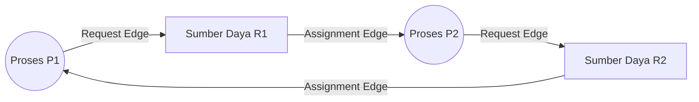

# Bahan Ajar: Minggu 6 - Deadlock: Karakterisasi, Penghindaran, dan Penanganan

**Mata Kuliah:** Manajemen Sumberdaya Sistem (MKK56301501)  
**Program Studi:** Teknologi Rekayasa Komputer (TRK)  
**Jurusan:** Rekayasa Pertanian dan Komputer – Politeknik Pertanian Negeri Payakumbuh  
**Pertemuan:** 6 (Enam) — Semester 5 / 2 SKS  
**Dosen Pengampu:** Melissa Triandini, M.Kom / Tim Dosen  
**Bahan Kajian:** BK02/MP-06  

---

## 1. Capaian Pembelajaran (Sub-CPMK) & Indikator

Pada akhir sesi perkuliahan ini, mahasiswa diharapkan mampu:
1. **Menjelaskan definisi formal *Deadlock*** dalam manajemen sumber daya komputasi.
2. **Menganalisis 4 Kondisi Coffman (*Coffman Conditions*)** yang menjadi syarat mutlak terjadinya *deadlock*.
3. **Membuat dan menganalisis *Resource Allocation Graph* (RAG)** serta membedakan kondisi sumber daya instans tunggal (*single instance*) vs banyak instans (*multiple instances*).
4. **Membedakan 4 strategi penanganan *deadlock***: *Deadlock Prevention*, *Deadlock Avoidance*, *Deadlock Detection & Recovery*, serta *The Ostrich Algorithm*.
5. **Menerapkan *Banker's Algorithm*** (Algoritma Keamanan & Algoritma Permintaan Sumber Daya) untuk menghitung matriks *Need*, vektor *Available*, dan menentukan *Safe Sequence*.
6. **Menjelaskan mekanisme pemulihan (*Recovery*) dari kebuntuan sistem**, termasuk terminasi proses dan *resource preemption*.

---

## 2. Definisi Formal Deadlock

**Deadlock** (Kebuntuan) adalah situasi di mana sekumpulan proses terhenti (*blocked*) secara permanen karena setiap proses menahan (*holding*) suatu sumber daya sementara menunggu (*waiting*) sumber daya lain yang sedang dipegang oleh proses lain di dalam kelompok yang sama.

```text
+----------+      Menahan (Holds) R1      +----------+
|          | ---------------------------> |          |
|  Proses  |                              |  Proses  |
|    P1    | <--------------------------- |    P2    |
+----------+      Menahan (Holds) R2      +----------+
     |                                         |
     | Meminta (Requests) R2                   | Meminta (Requests) R1
     +-----------------------------------------+
```

Jika P1 menunggu R2 yang dipegang P2, dan P2 menunggu R1 yang dipegang P1, kedua proses tidak akan pernah melepaskan sumber dayanya dan sistem membeku selamanya tanpa ada kemajuan komputasi.

---

## 3. Empat Kondisi Coffman (Karakterisasi Deadlock)

Menurut penelitian klasik E. G. Coffman (1971), sebuah situasi kebuntuan *deadlock* **HANYA DAPAT TERJADI** jika keempat kondisi berikut ini terpenuhi secara simultan:

1. **Mutual Exclusion (Eksklusi Bersama):** Minimal ada satu sumber daya yang bersifat tidak dapat dibagi (*non-shareable*), artinya hanya boleh digunakan oleh satu proses pada satu waktu (misal: tape drive, printer, atau mutex lock).
2. **Hold and Wait (Menahan dan Menunggu):** Sebuah proses sedang memegang minimal satu sumber daya, dan secara bersamaan mengajukan permintaan untuk memperoleh sumber daya tambahan yang saat itu sedang dipegang oleh proses lain.
3. **No Preemption (Tidak Ada Perebutan Paksa):** Sumber daya tidak dapat direbut paksa dari tangan proses yang sedang memegangnya. Sumber daya hanya dapat dilepaskan secara sukarela oleh proses yang bersangkutan setelah selesai digunakan.
4. **Circular Wait (Menunggu Melingkar):** Harus ada rantai tertutup proses $\{P_0, P_1, \dots, P_n\}$ di mana $P_0$ menunggu sumber daya yang ditahan $P_1$, $P_1$ menunggu sumber daya $P_2$, ..., dan $P_n$ menunggu sumber daya yang ditahan $P_0$.

---

## 4. Graf Alokasi Sumber Daya (Resource Allocation Graph / RAG)

Status alokasi sumber daya dalam sistem dapat direpresentasikan secara grafis menggunakan graf berarah terarah $G = (V, E)$:
- **Himpunan Simpul ($V$):** Terbagi menjadi simpul Proses ($P = \{P_1, P_2, \dots\}$ digambarkan sebagai lingkaran) dan simpul Tipe Sumber Daya ($R = \{R_1, R_2, \dots\}$ digambarkan sebagai kotak, dengan titik-titik di dalamnya melambangkan jumlah instans fisik).
- **Himpunan Sisi Berarah ($E$):**
  - **Request Edge ($P_i \to R_j$):** Proses $P_i$ sedang meminta instans dari sumber daya $R_j$ (panah mengarah ke kotak).
  - **Assignment Edge ($R_j \to P_i$):** Instans sumber daya $R_j$ telah dialokasikan kepada proses $P_i$ (panah berawal dari titik instans ke lingkaran).



### Teorema Graf Deadlock:
1. **Jika graf TIDAK memiliki siklus (*No Cycle*):** Sistem dijamin **TIDAK berada dalam keadaan deadlock**.
2. **Jika graf memiliki siklus (*Contains a Cycle*):**
   - **Kasus Single Instance:** Jika setiap tipe sumber daya hanya memiliki tepat 1 instans, maka keberadaan siklus adalah syarat perlu dan cukup $\rightarrow$ **SISTEM PASTI DEADLOCK**.
   - **Kasus Multiple Instances:** Jika tipe sumber daya memiliki lebih dari 1 instans, keberadaan siklus **BELUM TENTU DEADLOCK** (potensi deadlock dapat terhindar jika ada proses di luar siklus yang memegang instans sumber daya tersebut dan selesai dieksekusi lebih dulu).

---

## 5. Empat Strategi Menangani Deadlock

Sistem operasi menangani deadlock menggunakan salah satu dari empat pendekatan:

### 1. Mengabaikan Masalah (The Ostrich Algorithm)
- Meniru burung unta yang mengubur kepalanya di pasir: sistem berpura-pura bahwa deadlock tidak pernah terjadi.
- **Diterapkan oleh:** Sebagian besar sistem operasi komersial umum (termasuk Linux, Windows, macOS). 
- **Rasionalitas:** Biaya mendeteksi atau mencegah deadlock terus-menerus setiap milidetik jauh lebih mahal dibandingkan kerugian yang ditimbulkan oleh deadlock yang sangat jarang terjadi. Jika server macet, solusinya diserahkan kepada SysAdmin (me-reboot atau membunuh proses).

### 2. Pencegahan Deadlock (Deadlock Prevention)
Menghilangkan kemungkinan terjadinya deadlock secara struktural dengan cara **memastikan bahwa minimal salah satu dari 4 Kondisi Coffman tidak pernah terpenuhi**:
- *Menghilangkan Mutual Exclusion:* Membuat semua sumber daya dapat dibagi bersama (*shareable*, misal file read-only). Namun beberapa hardware mutlak tidak dapat dibagi (misal write lock).
- *Menghilangkan Hold and Wait:* Mewajibkan proses meminta seluruh sumber daya yang dibutuhkannya sekaligus di awal sebelum mulai berjalan. Kelemahan: Utilisasi hardware menjadi sangat rendah dan rentan *starvation*.
- *Menghilangkan No Preemption:* Jika proses memegang sumber daya dan meminta sumber daya baru yang sedang sibuk, seluruh sumber daya yang sedang ia pegang langsung dicabut paksa.
- *Menghilangkan Circular Wait (Paling Praktis):* Menetapkan urutan numerik global untuk seluruh sumber daya ($F(R) \to \mathbb{N}$). Proses hanya boleh meminta sumber daya dengan urutan nomor yang lebih tinggi dari sumber daya yang sedang dipegangnya.

### 3. Penghindaran Deadlock (Deadlock Avoidance)
Sistem memiliki informasi apriori tentang **jumlah maksimum sumber daya** yang mungkin akan diminta oleh setiap proses selama masa hidupnya.
- Sistem hanya akan mengabulkan permintaan sumber daya jika status sistem yang dihasilkan berada dalam **Safe State** (Keadaan Aman).
- *Safe State:* Terdapat sebuah urutan eksekusi aman (**Safe Sequence** $\langle P_1, P_2, \dots, P_n \rangle$) di mana seluruh proses dapat menyelesaikan pekerjaannya secara bertahap tanpa pernah macet.

### 4. Deteksi dan Pemulihan (Deadlock Detection and Recovery)
Sistem membiarkan deadlock terjadi, namun secara berkala menjalankan algoritma pendeteksi (seperti *Wait-for Graph*). Jika deadlock terdeteksi, sistem melakukan pemulihan melalui:
- **Terminasi Proses:** Menghentikan seluruh proses yang terlibat (*abort all*), atau menghentikan proses satu per satu (*abort one-by-one*) sampai siklus deadlock putus.
- **Perebutan Sumber Daya (*Resource Preemption*):** Memilih korban (*victim selection*), memutar balik status proses korban (*rollback* ke checkpoint sebelumnya), dan mencegah *starvation* agar proses yang sama tidak terus-menerus menjadi korban.

---

## 6. Algoritma Bankir (Banker's Algorithm)

Dirancang oleh Edsger Dijkstra, algoritma ini dinamakan *Banker's Algorithm* karena menganalogikan sistem komputer seperti bankir di kota kecil yang mengalokasikan kredit uang tunai kepada nasabah tanpa pernah kehabisan cadangan kas tunai.

### Struktur Data (untuk $n$ proses dan $m$ tipe sumber daya):
1. **`Available[m]`:** Vektor ketersediaan. Jika `Available[j] = k`, terdapat $k$ instans sumber daya $R_j$ yang bebas.
2. **`Max[n][m]`:** Matriks klaim maksimum. `Max[i][j] = k` berarti proses $P_i$ mungkin meminta maksimal $k$ instans $R_j$.
3. **`Allocation[n][m]`:** Matriks alokasi saat ini. `Allocation[i][j] = k` berarti $P_i$ sedang menahan $k$ instans $R_j$.
4. **`Need[n][m]`:** Matriks sisa kebutuhan di masa depan.
   $$\text{Need}[i][j] = \text{Max}[i][j] - \text{Allocation}[i][j]$$

### Safety Algorithm (Algoritma Pemeriksaan Keamanan):
1. Inisialisasi: `Work = Available` dan `Finish[i] = false` untuk seluruh $i = 0, 1, \dots, n-1$.
2. Cari indeks $i$ sedemikian rupa sehingga:
   $$\text{Finish}[i] == \text{false} \quad \text{dan} \quad \text{Need}_i \le \text{Work}$$
   Jika tidak ada $i$ yang memenuhi, lompat ke Langkah 4.
3. Alokasikan sumber daya ke $P_i$, asumsikan $P_i$ selesai dan mengembalikan seluruh alokasinya:
   $$\text{Work} = \text{Work} + \text{Allocation}_i, \quad \text{Finish}[i] = \text{true}$$
   Kembali ke Langkah 2.
4. Jika `Finish[i] == true` untuk seluruh $i$, maka sistem berada dalam **Safe State** dengan urutan proses yang tercatat sebagai **Safe Sequence**. Jika ada proses yang `Finish` bernilai false, sistem berada dalam **Unsafe State** (rentan deadlock).

---

## 7. Rangkuman Materi

1. **Deadlock** terjadi ketika proses-proses saling menunggu sumber daya yang ditahan sesamanya tanpa jalan keluar.
2. Syarat terjadinya deadlock adalah terpenuhinya keempat **Kondisi Coffman**: *Mutual Exclusion*, *Hold and Wait*, *No Preemption*, dan *Circular Wait*.
3. Pada graf alokasi sumber daya (**RAG**), keberadaan siklus pada sumber daya berinstans tunggal memastikan terjadinya deadlock.
4. Pendekatan **Penghindaran (Banker's Algorithm)** memeriksa apakah alokasi sumber daya akan mempertahankan sistem dalam status aman (*Safe State*).
5. Sistem operasi modern skala besar lebih banyak menggunakan pendekatan **Ostrich Algorithm** demi menjaga kecepatan dan kesederhanaan kernel.

---

## 8. Referensi Pustaka

- **Silberschatz, A., Galvin, P. B., & Gagne, G. (2019).** *Operating System Concepts* (10th Global Edition). John Wiley & Sons. **Chapter 8: Deadlocks (pp. 351–386).**
- **Tanenbaum, A. S., & Bos, H. (2022).** *Modern Operating Systems* (5th Edition). Pearson. **Chapter 6: Deadlocks (pp. 433–470).**
