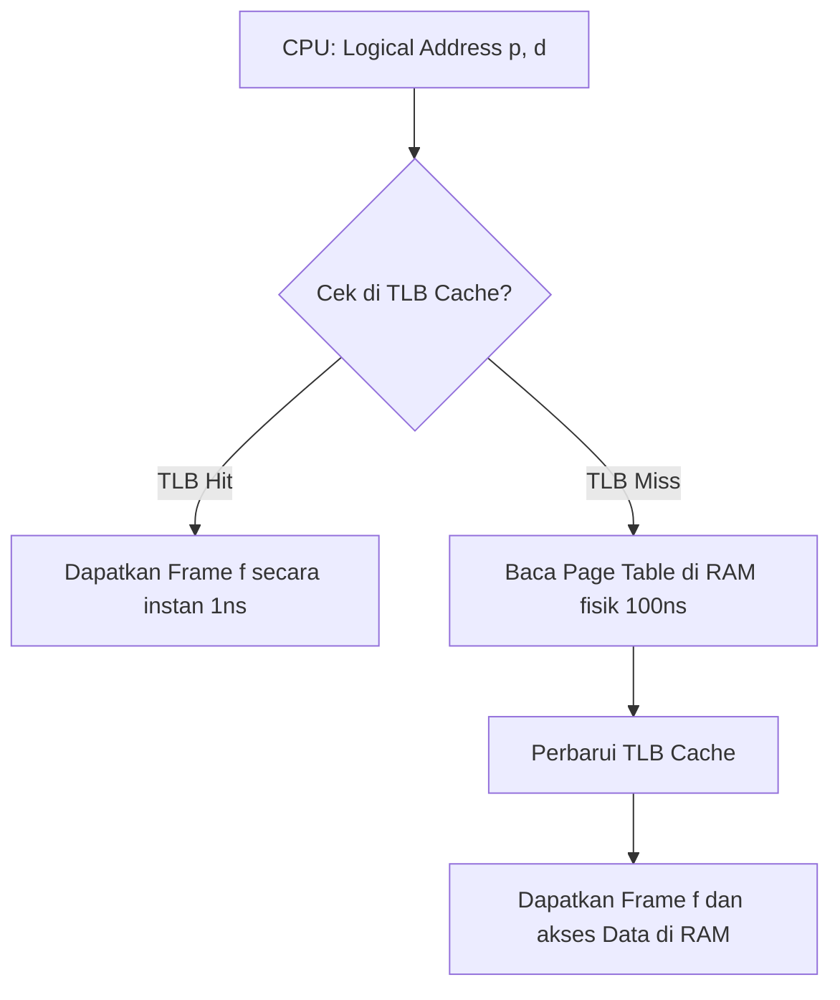

# Bahan Ajar: Minggu 7 - Manajemen Memori Utama

**Mata Kuliah:** Manajemen Sumberdaya Sistem (MKK56301501)  
**Program Studi:** Teknologi Rekayasa Komputer (TRK)  
**Jurusan:** Rekayasa Pertanian dan Komputer – Politeknik Pertanian Negeri Payakumbuh  
**Pertemuan:** 7 (Tujuh) — Semester 5 / 2 SKS  
**Dosen Pengampu:** Melissa Triandini, M.Kom / Tim Dosen  
**Bahan Kajian:** BK02/MP-07  

---

## 1. Capaian Pembelajaran (Sub-CPMK) & Indikator

Pada akhir sesi perkuliahan ini, mahasiswa diharapkan mampu:
1. **Menjelaskan konsep pengikatan alamat (*Address Binding*)** pada waktu kompilasi, waktu pemuatan (*load time*), dan waktu eksekusi (*execution time*).
2. **Membedakan Ruang Alamat Logika (*Logical / Virtual Address Space*) dengan Ruang Alamat Fisik (*Physical Address Space*)**, serta peran perangkat keras *Memory Management Unit* (MMU).
3. **Menganalisis strategi alokasi memori berdekatan (*Contiguous Allocation*)**: *First-Fit*, *Best-Fit*, dan *Worst-Fit*.
4. **Membedakan fragmentasi internal (*Internal Fragmentation*) dan fragmentasi eksternal (*External Fragmentation*)**, serta teknik pemadatan (*Compaction*).
5. **Menguasai arsitektur *Paging***: pemetaan nomor halaman (*Page Number* / $p$) dan pergeseran (*Offset* / $d$) ke dalam bingkai fisik (*Frame Number* / $f$).
6. **Menghitung *Effective Access Time* (EAT)** menggunakan *Translation Lookaside Buffer* (TLB).
7. **Membandingkan skema *Paging* dengan skema *Segmentation*** berdasarkan cara pandang programmer.

---

## 2. Pengikatan Alamat (Address Binding) dan Peran MMU

Sebuah program komputer tersimpan di dalam disk sebagai berkas biner eksekutabel. Agar dapat dieksekusi, program harus dibawa ke memori utama (RAM) dan diletakkan di dalam ruang alamat proses.

```text
Source Program -> [Compiler] -> Object Module -> [Linker] -> Load Module -> [Loader] -> In-Memory Binary
                  (Compile Time)                 (Link Time)                (Load Time)   (Execution Time)
```

### Tahapan Pengikatan Alamat (Address Binding):
1. **Compile Time:** Jika diketahui secara pasti di mana proses akan berada di RAM saat kompilasi, kode biner absolut dihasilkan. Jika lokasi berubah, program harus dikompilasi ulang.
2. **Load Time:** Kompiler menghasilkan kode biner yang dapat direlokasi (*relocatable code*). Pengikatan alamat final ditunda hingga program dimuat ke RAM oleh *loader*.
3. **Execution Time (Runtime):** Jika proses dapat dipindah-pindah (*swapped/relocated*) dari satu segmen memori ke segmen lain selama eksekusi berjalan, pengikatan ditunda hingga instruksi CPU dieksekusi secara aktual. Metode ini membutuhkan dukungan perangkat keras **Memory Management Unit (MMU)**.

### Relokasi Dinamis dengan MMU:
CPU membangkitkan **Logical Address** (Alamat Virtual), sedangkan chip RAM hanya mengenali **Physical Address** (Alamat Fisik). Perangkat keras MMU bertugas memetakan alamat logika ke alamat fisik secara instan saat siklus *memory access*.

$$\text{Physical Address} = \text{Logical Address} + \text{Relocation Register (Base)}$$

---

## 3. Alokasi Memori Berdekatan (Contiguous Allocation)

Pada masa awal sistem operasi, memori dialokasikan secara berurutan (*contiguous*), di mana seluruh kode dan data satu proses harus menempati satu blok memori utuh yang tersambung tanpa jeda.

### Strategi Penempatan Lubang Memori (Hole Allocation):
Ketika proses-proses datang dan pergi dari RAM, memori utama terpecah menjadi blok-blok terisi dan blok-blok kosong yang disebut **Holes** (lubang memori):

1. **First-Fit:** Mengalokasikan proses pada lubang memori pertama yang ditemukan dari atas yang ukurannya mencukupi. (Sangat cepat dalam pencarian).
2. **Best-Fit:** Mencari dan mengalokasikan proses pada lubang memori terkecil yang masih mencukupi kebutuhan proses. Menghasilkan sisa pecahan lubang sekecil mungkin. (Memerlukan pencarian ke seluruh daftar memori jika tidak diurutkan).
3. **Worst-Fit:** Mengalokasikan proses pada lubang memori terbesar yang tersedia. Tujuannya agar sisa lubang yang ditinggalkan masih cukup besar untuk proses lain. (Secara empiris kinerjanya paling buruk).

---

## 4. Analisis Fragmentasi Memori

Fragmentasi adalah fenomena di mana kapasitas memori utama terbuang sia-sia dan tidak dapat dimanfaatkan:

```text
+-------------------+--------------------+-------------------+--------------------+
| Proses A (2 MB)   | Lubang 1 (1 MB)    | Proses B (4 MB)   | Lubang 2 (1 MB)    |
+-------------------+--------------------+-------------------+--------------------+
                     ^                                        ^
                     |--- Total memori kosong = 2 MB, -------|
                          namun Proses C (2 MB) tidak bisa masuk! (Fragmentasi Eksternal)
```

1. **Fragmentasi Eksternal (External Fragmentation):**
   - Terjadi ketika total ruang memori bebas yang tersedia di sistem mencukupi untuk menampung proses baru, namun ruang bebas tersebut terpecah-pecah menjadi lubang-lubang kecil yang tidak berdekatan.
   - Solusi: **Compaction (Pemadatan)**, yaitu menggeser seluruh isi memori yang aktif ke satu sisi RAM sehingga seluruh lubang kosong bergabung menjadi satu blok besar. Namun, pemadatan memakan waktu CPU yang sangat besar.
2. **Fragmentasi Internal (Internal Fragmentation):**
   - Terjadi ketika memori dialokasikan dalam ukuran unit blok tetap (misalnya partisi 4 KB). Jika proses hanya membutuhkan 3 KB, sisa 1 KB di dalam partisi tersebut menganggur dan tidak boleh dipakai oleh proses lain.

---

## 5. Arsitektur Paging (Skema Memori Non-Berdekatan)

Untuk mengatasi fragmentasi eksternal secara permanen, sistem operasi modern beralih ke skema **Paging**:
- **Logical Memory** (ruang alamat proses) dipecah menjadi blok-blok berukuran tetap yang disebut **Pages** (Halaman).
- **Physical Memory** (RAM fisik) dipecah menjadi blok-blok dengan ukuran yang persis sama yang disebut **Frames** (Bingkai). Ukuran umum satu frame adalah **4 KB (4.096 byte)**.
- *Keunggulan Utama:* Bagian-bagian dari satu proses yang sama dapat diletakkan di frame fisik mana pun di RAM, tidak perlu berurutan!

```text
LOGICAL ADDRESS:
+---------------------+---------------------+
| Page Number (p)     | Page Offset (d)     |
+---------------------+---------------------+
           |                     |
           v                     |
     +-----------+               |
   p | Frame (f) |               |
     +-----------+               |
           |                     |
           v                     v
+---------------------+---------------------+
| Frame Number (f)    | Page Offset (d)     |
+---------------------+---------------------+
PHYSICAL ADDRESS (Dikirim ke Bus RAM)
```

### Rumus Translasi Alamat:
Jika ukuran halaman adalah $\text{Page Size} = 2^n$ byte, dan sebuah alamat logika dinyatakan dalam angka desimal $\text{LA}$:
1. **Nomor Halaman ($p$):**
   $$p = \lfloor \text{LA} / \text{Page Size} \rfloor$$
2. **Pergeseran / Offset ($d$):**
   $$d = \text{LA} \pmod{\text{Page Size}}$$
3. **Alamat Fisik (Physical Address / PA):**
   $$\text{PA} = (f \times \text{Page Size}) + d$$
   *(di mana $f = \text{Page Table}[p]$)*.

---

## 6. Perangkat Keras TLB (Translation Lookaside Buffer)

Menyimpan Page Table di RAM menimbulkan masalah kinerja: setiap instruksi program membutuhkan **dua kali akses RAM fisik** (akses pertama untuk membaca Page Table, akses kedua untuk mengambil data instruksi sebenarnya).

Untuk mengatasinya, chip CPU dilengkapi dengan *hardware cache* asosiatif berkecepatan tinggi bernama **Translation Lookaside Buffer (TLB)**.



### Perhitungan Effective Access Time (EAT):
Jika waktu akses TLB adalah $t_{\text{TLB}} = 1\text{ ns}$, waktu akses RAM adalah $t_{\text{RAM}} = 100\text{ ns}$, dan tingkat kecocokan TLB (*Hit Ratio*) adalah $\alpha = 90\%$ (0,90):
$$\text{EAT} = \alpha \times (t_{\text{TLB}} + t_{\text{RAM}}) + (1 - \alpha) \times (t_{\text{TLB}} + 2 \times t_{\text{RAM}})$$
$$\text{EAT} = 0,90 \times (1 + 100) + 0,10 \times (1 + 200) = 0,90 \times 101 + 0,10 \times 201 = 90,9 + 20,1 = \mathbf{111\text{ ns}}$$
*(Dibandingkan tanpa TLB yang selalu memakan $200\text{ ns}$, TLB mempercepat kinerja sistem hampir dua kali lipat!)*.

---

## 7. Segmentasi (Segmentation)

Berbeda dengan Paging yang membagi memori secara mekanis (blok tetap 4 KB) tanpa memedulikan logika kode, **Segmentasi** membagi memori sesuai dengan cara pandang pemrogram (*programmer's view* of memory).
- Sebuah program dipandang sebagai sekumpulan segmen logika yang ukurannya bervariasi:
  - Segmen 0: Fungsi `main()`
  - Segmen 1: Modul pustaka matematika
  - Segmen 2: Struktur data Stack
  - Segmen 3: Alokasi Heap
- Menggunakan **Segment Table** yang menyimpan sepasang nilai: `<Base, Limit>`. Jika alamat logika melampaui `Limit`, MMU membangkitkan *Trap / Segmentation Fault*.

---

## 8. Rangkuman Materi

1. **Address Binding** pada waktu eksekusi (*Runtime*) memberikan fleksibilitas relokasi memori melalui dukungan perangkat keras **MMU**.
2. Alokasi berdekatan (*Contiguous Allocation*) mengalami degradasi akibat **Fragmentasi Eksternal**, yang memerlukan pemadatan memori (*Compaction*).
3. **Paging** membagi logika memori ke dalam *Pages* dan fisik memori ke dalam *Frames*, melenyapkan fragmentasi eksternal secara total.
4. Perangkat keras **TLB** berfungsi sebagai cache cepat translasi alamat, memangkas overhead akses memori ganda pada sistem paging.
5. **Segmentasi** membagi memori berdasarkan struktur logis program (fungsi, array, stack), melengkapi konsep paging pada arsitektur hybrid modern.

---

## 9. Referensi Pustaka

- **Silberschatz, A., Galvin, P. B., & Gagne, G. (2019).** *Operating System Concepts* (10th Global Edition). John Wiley & Sons. **Chapter 9: Main Memory (pp. 391–440).**
- **Tanenbaum, A. S., & Bos, H. (2022).** *Modern Operating Systems* (5th Edition). Pearson. **Chapter 3: Memory Management — Base and Limit Registers, Swapping, Paging, and Segmentation (pp. 185–224).**
