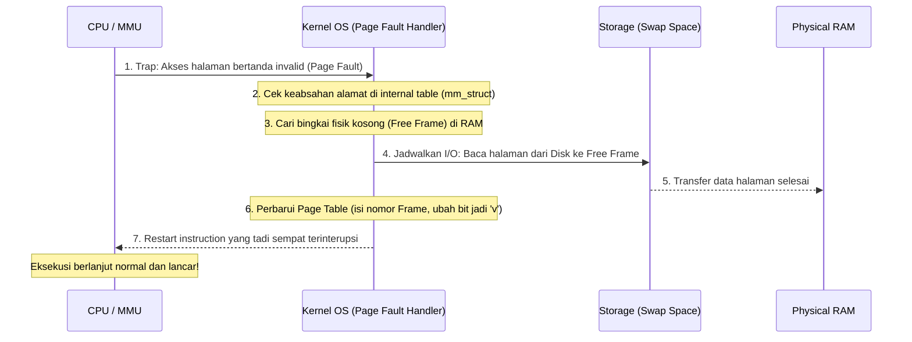

# Bahan Ajar: Minggu 9 - Memori Virtual (Virtual Memory)

**Mata Kuliah:** Manajemen Sumberdaya Sistem (MKK56301501)  
**Program Studi:** Teknologi Rekayasa Komputer (TRK)  
**Jurusan:** Rekayasa Pertanian dan Komputer – Politeknik Pertanian Negeri Payakumbuh  
**Pertemuan:** 9 (Sembilan) — Semester 5 / 2 SKS  
**Dosen Pengampu:** M. Riza Nurtam, M.Kom  
**Bahan Kajian:** BK02/MP-09  

---

## 1. Capaian Pembelajaran (Sub-CPMK) & Indikator

Pada akhir sesi perkuliahan ini, mahasiswa diharapkan mampu:
1. **Menjelaskan konsep dasar Memori Virtual** dan keuntungannya dalam menjalankan program yang ukurannya melampaui kapasitas fisik RAM.
2. **Menguraikan mekanisme *Demand Paging*** dan arti status bit *Valid-Invalid* pada tabel halaman.
3. **Menganalisis 7 tahapan kronologis penanganan interupsi kesalahan halaman (*Page Fault Handling*)**.
4. **Menghitung dan membandingkan efisiensi algoritma *Page Replacement***: FIFO, LRU, dan *Optimal Replacement*.
5. **Menganalisis fenomena *Belady's Anomaly*** pada algoritma FIFO serta algoritma berbasis *Stack (Stack Algorithms)*.
6. **Mendiagnosis penyebab, gejala, dan solusi dari fenomena *Thrashing*** pada sistem operasi server menggunakan *Working-Set Model*.

---

## 2. Fondasi Memori Virtual

Pada arsitektur sistem operasi generasi awal, seluruh kode biner dan data program harus dimuat ke dalam RAM secara utuh agar program dapat berjalan. Hal ini membatasi ukuran aplikasi sebesar kapasitas fisik RAM yang terpasang.

**Memori Virtual** adalah teknik pemisahan antara ruang alamat logika pengguna (*User Logical Memory*) dengan ruang alamat fisik komputer (*Physical Memory*). 

```text
VIRTUAL ADDRESS SPACE (Bisa berukuran hingga ratusan Gigabyte)
+-----------------------------------------------------------------+
| Code | Data | Heap |            ...             | Stack         |
+-----------------------------------------------------------------+
        |                                            |
        | (Hanya halaman yang sedang aktif dimuat)   |
        v                                            v
+-----------------------+                    +--------------------+
| RAM Fisik (misal 8 GB)|                    | Swap Space di SSD  |
| [Frame 0] [Frame 1]   |                    | (Penyimpanan Luas) |
+-----------------------+                    +--------------------+
```

### Keuntungan Memori Virtual:
1. Program tidak lagi dibatasi oleh ukuran RAM fisik yang tersedia. Pengguna dapat menjalankan program berukuran 32 GB pada mesin dengan RAM 8 GB.
2. Memperbesar derajat *multiprogramming* karena setiap program hanya menghabiskan sebagian kecil frame RAM fisik.
3. Mempercepat waktu pemuatan program (*loading time*) karena sistem tidak perlu membaca seluruh file biner program ke RAM sebelum mulai mengeksekusi instruksi pertama.
4. Memudahkan mekanisme berbagi memori (*shared memory* dan pustaka dinamis *shared libraries*).

---

## 3. Pemuatan Berdasarkan Kebutuhan (Demand Paging)

Dalam sistem **Demand Paging**, halaman (*pages*) hanya dimuat ke memori fisik ketika benar-benar dipanggil/dibutuhkan selama eksekusi program (*Lazy Swapper / Pager*).

### Peran Bit Valid-Invalid pada Page Table:
Untuk mendukung demand paging, setiap entri pada *Page Table* dilengkapi dengan satu bit khusus bernama **Valid-Invalid Bit**:
- **Valid (`v`):** Halaman tersebut sah dan **sedang berada di RAM fisik**.
- **Invalid (`i`):** Halaman tersebut mungkin tidak sah (di luar ruang alamat proses) ATAU sah namun **masih berada di media penyimpanan sekunder (disk/swap)**.

```text
Page Table:
Page 0: [Frame 4 | v] -> Berada di RAM Frame 4
Page 1: [Frame - | i] -> Belum dimuat (ada di Disk)
Page 2: [Frame 7 | v] -> Berada di RAM Frame 7
```

---

## 4. Siklus Penanganan Kesalahan Halaman (Page Fault Handling)

Jika proses mencoba mengakses sebuah halaman memori yang ditandai dengan bit **Invalid (`i`)**, perangkat keras MMU mendeteksi kegagalan translasi dan membangkitkan interupsi internal berupa **Page Fault Trap** ke kernel sistem operasi.



### 7 Tahapan Kronologis:
1. CPU mengeksekusi instruksi yang mengakses alamat memori logika.
2. MMU memeriksa Page Table. Jika mendapati bit `i`, MMU memicu *Page Fault Trap* ke sistem operasi.
3. Kernel menyimpan status proses saat itu, lalu memeriksa tabel internal apakah akses tersebut legal. (Jika ilegal, kernel membangkitkan sinyal `SIGSEGV` / *Segmentation Fault* dan mematikan proses).
4. Jika legal, kernel mencari bingkai fisik yang kosong (*Free Frame*) dari daftar ketersediaan (*Free-Frame List*).
5. Kernel menjadwalkan operasi baca dari disk untuk memindahkan halaman yang diminta dari swap area ke frame fisik yang baru dialokasikan.
6. Setelah pembacaan I/O tuntas, kernel memperbarui tabel halaman: mencatat nomor frame fisik dan mengubah bit dari `i` menjadi `v`.
7. Kernel menginstruksikan CPU untuk mengulang kembali (*restart*) instruksi yang sempat gagal, dan proses kini dapat membaca datanya secara instan dari RAM.

---

## 5. Algoritma Penggantian Halaman (Page Replacement)

Jika saat terjadi *Page Fault* ternyata **seluruh frame fisik RAM telah penuh**, sistem operasi harus memilih salah satu halaman yang ada di RAM untuk dikeluarkan (*swapped out / paged out*) ke disk demi memberi ruang bagi halaman baru yang datang. Halaman yang dikeluarkan disebut sebagai **Victim Page**.

> **Optimasi Dirty Bit (Modify Bit):**  
> Setiap frame memori memiliki flag *Dirty Bit*. Jika halaman di RAM belum pernah dimodifikasi (hanya dibaca), halaman tersebut tidak perlu ditulis kembali ke disk saat diganti (cukup ditimpa langsung), menghemat waktu I/O disk hingga 50%!

### A. Algoritma First-In, First-Out (FIFO)
- **Mekanisme:** Halaman yang paling awal masuk ke memori fisik adalah halaman yang paling pertama dipilih sebagai korban penggantian.
- **Anomali Belady (Belady's Anomaly):**  
  Secara intuisi, menambah kapasitas RAM fisik (menambah jumlah frame) seharusnya menurunkan jumlah *Page Fault*. Namun pada algoritma FIFO, untuk *reference string* tertentu, **menambah jumlah frame justru meningkatkan jumlah Page Fault!**

### B. Algoritma Optimal (OPT / MIN)
- **Mekanisme:** Ganti halaman yang **paling lama tidak akan digunakan di masa depan**.
- **Karakteristik:** Menghasilkan jumlah *Page Fault* paling minimum untuk sembarang deretan akses memori dan dijamin bebas dari Anomali Belady.
- **Tantangan:** Algoritma ini **tidak dapat diimplementasikan secara nyata** pada sistem operasi karena kernel tidak dapat meramal masa depan kode pengguna. Algoritma ini murni digunakan sebagai tolok ukur ideal (*benchmark*) untuk mengukur performa algoritma lain.

### C. Algoritma Least Recently Used (LRU)
- **Mekanisme:** Menggunakan riwayat masa lalu sebagai pendekatan masa depan: ganti halaman yang **paling lama tidak pernah diakses di masa lalu**.
- Menghasilkan performa yang mendekati Algoritma Optimal dan termasuk ke dalam kelompok *Stack Algorithms* (kebal dari Anomali Belady).
- *Pendekatan Praktis di Kernel:* Karena mencatat *timestamp* setiap siklus jam sangat mahal bagi hardware, OS modern menggunakan pendekatan aproksimasi seperti **Clock Algorithm (Second-Chance Algorithm)** menggunakan *Reference Bit*.

---

## 6. Fenomena Thrashing dan Working-Set Model

### A. Apa itu Thrashing?
**Thrashing** adalah kondisi bencana performa di mana sistem operasi menghabiskan hampir **100% waktunya sibuk melakukan operasi I/O penukaran halaman (*paging in and paging out*)** antara RAM dan disk, sementara utilisasi komputasi CPU anjlok mendekati 0%.

```text
Utilitas
  CPU (%)
   100 |                Puncak Utilisasi
       |                     /\
       |                    /  \
       |                   /    \  <--- Titik Runtuh (Thrashing Terjadi)
       |                  /      \
       |                 /        \
     0 +----------------/----------\------------
       Derajat Multiprogramming (Jumlah Proses)
```

### B. Mengapa Thrashing Terjadi?
1. Administrator menjalankan terlalu banyak proses secara bersamaan (derajat *multiprogramming* terlalu tinggi).
2. Jumlah frame RAM fisik yang dialokasikan untuk setiap proses menjadi terlalu sedikit, berada di bawah batas minimum kebutuhan halaman aktifnya (**Working Set**).
3. Akibatnya, setiap kali proses mendapatkan giliran CPU, ia langsung mengalami *Page Fault*. Proses tersebut terblokir menunggu antrean disk I/O, CPU menganggur (*idle*).
4. Penjadwal OS melihat CPU menganggur, secara keliru mengira bahwa beban sistem ringan, lalu menambahkan proses baru lagi ke antrean, memperparah antrean disk hingga sistem macet total (*freeze*).

### C. Solusi Mitigasi Thrashing:
- **Working-Set Model:** Kernel memantau parameter jendela $\Delta$ (*Working-Set Window*). Jika total kebutuhan halaman semua proses aktif melampaui total frame fisik yang tersedia ($\sum WSS_i > D$), kernel menangguhkan (*suspends*) salah satu proses untuk membebaskan frame.
- **Page-Fault Frequency (PFF):** Menetapkan ambang batas atas dan bawah frekuensi page fault. Jika laju page fault proses melampaui ambang batas atas, tambahkan frame; jika di bawah ambang bawah, kurangi frame.
- **Solusi Administrator:** Mematikan proses rakus memori atau menambah kapasitas memori RAM fisik.

---

## 7. Rangkuman Materi

1. **Memori Virtual** memisahkan ruang alamat logika dari memori fisik, memungkinkan eksekusi program berukuran besar secara transparan.
2. **Demand Paging** memuat halaman hanya saat dibutuhkan, dikawal oleh bit valid-invalid pada tabel halaman.
3. Terjadinya **Page Fault** memicu 7 tahapan penanganan terstruktur oleh kernel untuk menjemput data dari swap area tanpa membatalkan program.
4. Algoritma **Optimal** adalah batas teoritis terbaik, **FIFO** rentan terhadap *Belady's Anomaly*, dan **LRU / Clock** menjadi standar implementasi industri.
5. Kegagalan alokasi frame minimum menyebabkan **Thrashing**, di mana sistem lumpuh akibat antrean pertukaran halaman disk tanpa henti.

---

## 8. Referensi Pustaka

- **Silberschatz, A., Galvin, P. B., & Gagne, G. (2019).** *Operating System Concepts* (10th Global Edition). John Wiley & Sons. **Chapter 10: Virtual Memory (pp. 389–448).**
- **Tanenbaum, A. S., & Bos, H. (2022).** *Modern Operating Systems* (5th Edition). Pearson. **Chapter 3: Page Replacement Algorithms, Design Issues for Paging Systems, and Thrashing (pp. 225–278).**
- **Nemeth, E., et al. (2017).** *UNIX and Linux System Administration Handbook* (5th Edition). Pearson. **Chapter 28: Performance Analysis & Memory Bottlenecks.**
