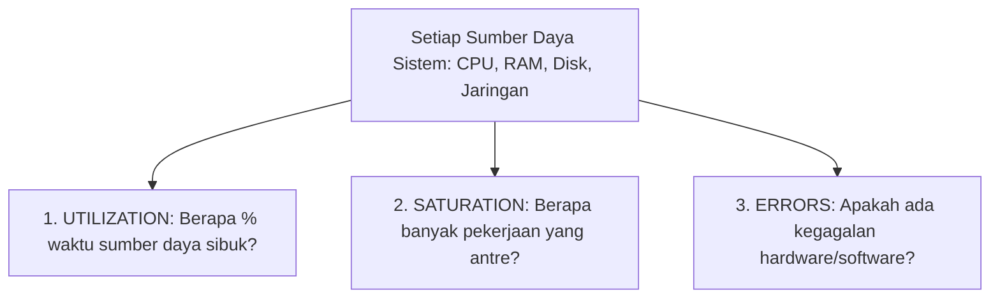

# Bahan Ajar: Minggu 15 - Monitoring dan Evaluasi Kinerja Sistem

**Mata Kuliah:** Manajemen Sumberdaya Sistem (MKK56301501)  
**Program Studi:** Teknologi Rekayasa Komputer (TRK)  
**Jurusan:** Rekayasa Pertanian dan Komputer – Politeknik Pertanian Negeri Payakumbuh  
**Pertemuan:** 15 (Lima Belas) — Semester 5 / 2 SKS  
**Dosen Pengampu:** M. Riza Nurtam, M.Kom  
**Bahan Kajian:** BK02/MP-15  

---

## 1. Capaian Pembelajaran (Sub-CPMK) & Indikator

Pada akhir sesi perkuliahan ini, mahasiswa diharapkan mampu:
1. **Menerapkan Metodologi USE (*Utilization, Saturation, and Errors*)** dalam menganalisis kesehatan sumber daya sistem operasi.
2. **Mendiagnosis tiga bentuk kemacetan sistem (*System Bottlenecks*)**: kondisi *CPU-Bound*, *Memory-Bound*, dan *I/O-Bound*.
3. **Menganalisis arti matematis dari metrik *Load Average*** di Linux dalam kaitannya dengan jumlah inti prosesor (*CPU Cores*).
4. **Menggunakan berbagai perangkat bantu monitoring CLI Linux** (`htop`, `vmstat`, `iotop`, `free`) untuk melacak konsumsi sumber daya.
5. **Menerapkan penalaan prioritas proses (*Process Priority Tuning*)** menggunakan perintah `nice` dan `renice`.
6. **Menyusun strategi perencanaan kapasitas (*Capacity Planning*)** untuk mencegah kelangkaan sumber daya di masa depan.
7. **Mempresentasikan hasil evaluasi Proyek Akhir (Tugas Besar)** sesuai rubrik penilaian RPS.

---

## 2. Paradigma Rekayasa Kinerja dan Metodologi USE

Seorang administrator sistem (*SysAdmin*) atau *DevOps Engineer* profesional tidak boleh bersikap reaktif (hanya bertindak saat server sudah mati / *firefighting*). Kinerja sistem harus diukur secara proaktif dan berkelanjutan.

Pakar rekayasa kinerja sistem ternama, **Brendan Gregg**, merumuskan **Metodologi USE** (*Utilization, Saturation, and Errors*) sebagai standar analisis setiap sumber daya fisik (CPU, Memori, Bus I/O, Disk, Jaringan):



1. **Utilization (Utilisasi):** Persentase waktu dalam rentang pengukuran di mana sumber daya aktif melayani pekerjaan (misal: utilisasi CPU 85% atau bandwidth disk 70%).
2. **Saturation (Saturasi):** Derajat kelebihan beban di mana pekerjaan tambahan tidak dapat langsung dilayani dan terpaksa menumpuk di antrean (*queue length*). Saturasi adalah indikator awal sebelum sistem mengalami degradasi parah.
3. **Errors (Kesalahan):** Jumlah kejadian error (seperti paket jaringan yang di-drop pada NIC atau bad sector pada hard disk).

---

## 3. Mendiagnosis Tiga Jenis Bottleneck Sistem

Ketika server berjalan sangat lambat, administrator harus mampu mengidentifikasi akar penyebabnya (*Root Cause Analysis*):

```text
1. CPU-BOUND                           2. MEMORY-BOUND                       3. I/O-BOUND
+--------------------------------+     +-------------------------------+     +--------------------------------+
| %us (User CPU) -> 95% - 100%   |     | RAM Free -> Mendekati 0 MB    |     | %us CPU -> Rendah (5% - 15%)   |
| Load Average >> Jumlah Cores   |     | Swap Used -> Naik tajam       |     | %wa (I/O Wait) -> Tinggi (>40%)|
| Komputasi murni padat          |     | Terjadi Thrashing Paging      |     | Proses mandek di status 'D'    |
+--------------------------------+     +-------------------------------+     +--------------------------------+
```

### A. Gejala CPU-Bound:
- Utilisasi prosesor di ruang pengguna (`%us` / user) atau ruang kernel (`%sy` / system) mendekati 100%.
- Panjang antrean proses di *Ready Queue* membengkak.
- **Penyebab Umum:** Kompresi video/gambar, komputasi enkripsi masif, algoritma rekursif tanpa batas (*infinite loop*), atau *traffic spike* pada backend API.

### B. Gejala Memory-Bound:
- Kapasitas memori bebas (`free`) dan `available` menipis drastis.
- Ruang partisi *Swap* mulai terisi secara agresif.
- Muncul lonjakan laju penukaran halaman memori (*Swap-In / Swap-Out* pada kolom `si`/`so` perintah `vmstat`), menandakan terjadinya **Thrashing**.

### C. Gejala I/O-Bound (Disk / Network Bottleneck):
- Penggunaan komputasi CPU sebenarnya sangat rendah (`%us` kecil).
- Namun, metrik persentase waktu CPU menunggu respon I/O (**`%wa` / I/O Wait**) melonjak tinggi (misal > 30%–50%).
- Banyak proses beralih ke status **`D` (Uninterruptible Sleep)** karena tertahan menunggu piringan disk berputar atau koneksi database jaringan merespons.
- Nilai *Load Average* tetap tinggi meskipun prosesor tidak sedang bekerja keras!

---

## 4. Membedah Makna Matematis Metrik Load Average di Linux

Saat menjalankan perintah `uptime` atau melihat *header* `htop`, kita disajikan 3 angka:
```text
load average: 2.50,  1.80,  1.10
              (1 min) (5 min) (15 min)
```

### Apa Arti Angka Tersebut?
**Load Average** merepresentasikan jumlah rata-rata proses yang menuntut akses komputasi pada interval waktu 1 menit, 5 menit, dan 15 menit terakhir.

> **Kekhasan Khusus Kernel Linux:**  
> Pada sistem Unix tradisional, Load Average hanya menghitung proses berstatus `R` (*Running / Runnable* di antrean CPU). Namun pada **Linux**, Load Average menghitung proses berstatus **`R` (di antrean CPU) DITAMBAH proses berstatus `D` (*Uninterruptible Sleep* yang sedang menunggu I/O disk)**. Oleh karena itu, di Linux, Load Average yang tinggi bisa disebabkan oleh CPU yang sibuk ATAU antrean disk I/O yang macet!

### Cara Menginterpretasikan Load Average terhadap Jumlah CPU Core ($N$):
Misalkan sebuah server memiliki prosesor **4 Core CPU ($N = 4$)**:
- **Load Average = 2,00:** Kapasitas utilisasi sistem adalah $2 / 4 = 50\%$. Sistem beroperasi sangat santai dan memiliki cadangan daya 50%.
- **Load Average = 4,00:** Sistem bekerja pada kapasitas penuh ideal 100% ($4 / 4 = 1,00$). Seluruh core terpakai, namun belum ada antrean yang tertunda.
- **Load Average = 8,00:** Sistem mengalami kelebihan beban (*Overload*) sebesar 200%. Rata-rata ada 4 proses yang sedang dieksekusi di 4 core, dan ada **4 proses lain yang terpaksa antre menunggu giliran**.
- **Analisis Tren Waktu:**
  - `Load: 0.50, 1.50, 3.00` $\rightarrow$ Beban sistem sedang **menurun** (dari 3.00 menuju 0.50).
  - `Load: 4.50, 2.00, 0.80` $\rightarrow$ Beban sistem sedang **melonjak tajam** dalam 1 menit terakhir.

---

## 5. Perkakas Monitoring Esensial Linux

| Perangkat CLI | Fokus Pemantauan | Parameter & Metrik Kunci |
| :---: | :--- | :--- |
| **`htop`** | Pemantau interaktif proses & CPU multi-core | Tampilan grafis bar CPU per-core, bar RAM/Swap, kolom PID, USER, PRI, NI, %CPU, %MEM, dan Command Tree (`F5`). |
| **`vmstat 1`** | Metrik virtual memory dan subsistem kernel per detik | Kolom `r` (proses runnable), `b` (proses blocked I/O), `si`/`so` (swap in/out), `wa` (I/O wait), `id` (idle). |
| **`iotop`** | Pelacak proses yang membebani disk I/O secara real-time | Kolom `DISK READ` dan `DISK WRITE` per PID untuk menemukan proses yang menghabiskan bandwidth disk. |
| **`free -h`** | Ringkasan kapasitas RAM dan Swap | Kolom `total`, `used`, `free`, `buff/cache` (alokasi cache I/O), dan `available` (sisa RAM aman untuk aplikasi baru). |
| **`ss -tulpn`** | Pemantau soket jaringan dan port server | Menampilkan port TCP/UDP yang sedang listening dan PID proses pengelolanya. |

---

## 6. Penalaan Kinerja: Konsep Niceness dan Renice

Penjadwal Linux (CFS) mengalokasikan jatah siklus CPU berdasarkan prioritas proses. Tingkat prioritas pengguna diatur melalui nilai **Niceness (`NI`)**:

```text
-20 (Paling Agresif / Egois) <----------- 0 (Default) -----------> +19 (Paling Sopan / Santai)
Mendapat jatah CPU terbesar                                       Hanya memakai CPU sisa
(Hanya 'root' yang boleh set)                                     (Cocok untuk batch task)
```

- Nilai Niceness berkisar dari **`-20`** (prioritas tertinggi) hingga **`19`** (prioritas terendah).
- Mengapa disebut *Nice*? Karena proses dengan nilai 19 bersikap "sangat sopan" (*nice*) kepada proses lain, rela mengalah dan hanya menggunakan siklus CPU jika tidak ada proses lain yang membutuhkannya.

### Praktik Perintah CLI:
1. **Menjalankan proses baru dengan prioritas rendah (Nice 15):**
   ```bash
   nice -n 15 tar -czf backup_besar.tar.gz /var/data &
   ```
   *Keuntungan:* Proses kompresi backup yang berat tidak akan mengganggu responsivitas web server utama.
2. **Mengubah prioritas proses yang sedang berjalan (`renice`):**
   ```bash
   # Menaikkan prioritas sebuah proses penting (misal PID 1240) menjadi prioritas tinggi:
   sudo renice -n -5 -p 1240
   ```

---

## 7. Perencanaan Kapasitas (Capacity Planning)

**Capacity Planning** adalah proses memprediksi kapan sumber daya komputasi (CPU, RAM, Storage, Network) akan habis terlampaui berdasarkan tren pertumbuhan penggunaan historis, sehingga peningkatan hardware atau skalabilitas cloud dapat disiapkan sebelum terjadi bencana *downtime*.

### Siklus Perencanaan Kapasitas:
1. **Establish Baselines:** Mencatat konsumsi rata-rata sistem pada kondisi operasional normal.
2. **Identify Resource Ceilings:** Menetapkan batas aman sebelum kinerja anjlok (misal: utilisasi RAM tidak boleh lewat 80%, disk storage tidak boleh lewat 85%).
3. **Trend Forecasting:** Menganalisis kurva pertumbuhan (contoh: basis data bertambah 20 GB per bulan, maka sisa storage 100 GB akan habis tepat dalam 5 bulan ke depan).
4. **Procurement / Scaling Plan:** Menjadwalkan pengadaan atau konfigurasi auto-scaling sebelum titik jenuh tercapai.

---

## 8. Rangkuman Materi

1. **Metodologi USE** mengevaluasi kesehatan sumber daya berdasarkan *Utilization*, *Saturation*, dan *Errors*.
2. Bottleneck diklasifikasikan menjadi **CPU-Bound** (`%us` tinggi), **Memory-Bound** (thrashing swap), dan **I/O-Bound** (`%wa` tinggi).
3. Di Linux, **Load Average** menghitung proses antre CPU dan proses tertahan I/O, dinilai terhadap jumlah core fisik ($N$).
4. Penalaan prioritas proses dikendalikan oleh nilai **Niceness** (-20 s.d. 19) melalui perintah `nice` dan `renice`.
5. **Capacity Planning** menjamin kesinambungan layanan sistem dengan memproyeksikan kebutuhan sumber daya sebelum batas plafon terlampaui.

---

## 9. Referensi Pustaka

- **Nemeth, E., et al. (2017).** *UNIX and Linux System Administration Handbook* (5th Edition). Pearson. **Chapter 28: Performance Analysis (pp. 855–886).**
- **Gregg, B. (2020).** *Systems Performance: Enterprise and the Cloud* (2nd Edition). Addison-Wesley. **Chapter 2: Methodologies (The USE Method); Chapter 6: CPUs; Chapter 7: Memory.**
- **Silberschatz, A., Galvin, P. B., & Gagne, G. (2019).** *Operating System Concepts* (10th Global Edition). John Wiley & Sons. **Chapter 19: Real-Time & Performance Evaluation.**
